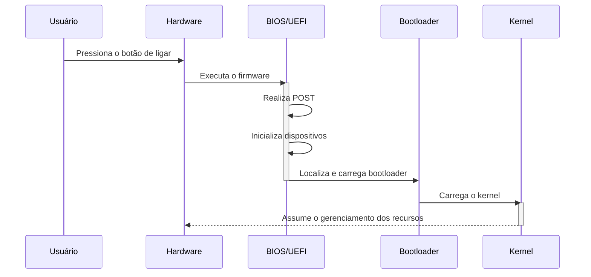
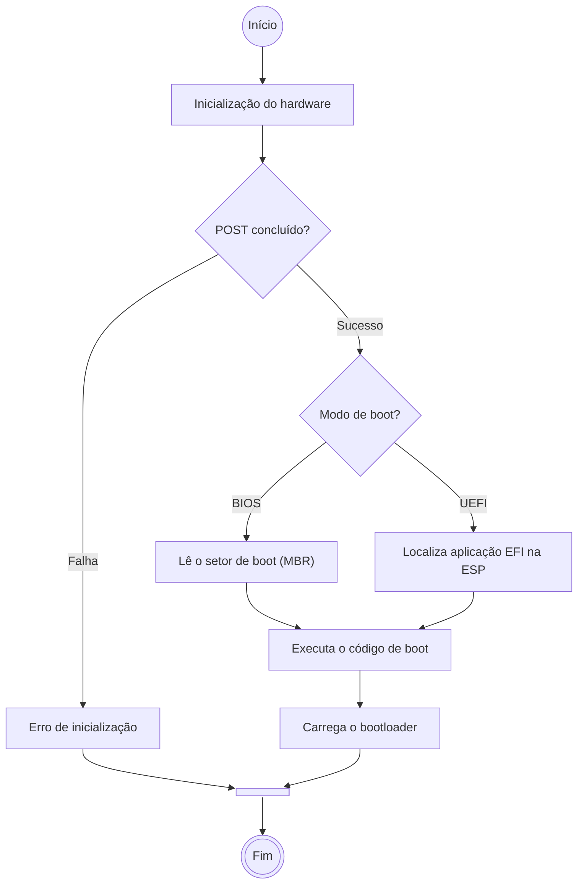

# **BIOS | UEFI**

Após concluirmos os [Primeiros Passos](../../Primeiros_Passos/base-inicial.md) do nosso framework, por meio da construção de uma **base inicial**, iniciaremos agora uma nova etapa do projeto. Diferentemente da abordagem anterior, cujo objetivo era construir um sistema operacional mínimo e funcional, nosso foco passará a ser o entendimento dos componentes, mecanismos e conceitos que fundamentam a arquitetura de uma distribuição GNU/Linux.

Nesse contexto, compreender a estrutura de um sistema operacional exige ir além do próprio software. Afinal, um sistema operacional atua como intermediário entre o hardware e as aplicações, oferecendo mecanismos para que os recursos físicos do computador sejam utilizados e gerenciados pelo software.

Por esse motivo, antes de entrarmos nos componentes que constituem o ambiente de execução do sistema operacional propriamente dito, precisamos compreender o processo que permite sua inicialização. Começaremos, portanto, pelo *firmware* da placa-mãe, responsável pelas primeiras etapas de inicialização do computador: a **BIOS (Basic Input/Output System)** e sua evolução, a **UEFI (Unified Extensible Firmware Interface)**.

## **Início**

Ao ligarmos um computador, é necessário que o hardware passe por uma série de procedimentos de inicialização antes que o sistema operacional possa ser carregado. Para isso, as placas-mãe possuem um *firmware* responsável por realizar as primeiras configurações e verificações do hardware, preparando o ambiente para a inicialização do sistema.

Historicamente, existem duas tecnologias principais utilizadas para essa finalidade:
* `BIOS` (_Basic Input/Output System_), *firmware* legado de 1980 muito utilizado em computadores mais antigos;
* `UEFI` (_Unified Extensible Firmware Interface_), a alternativa moderna para substituir as limitações da arquitetura tradicional do BIOS.

Embora ambos tenham o mesmo objetivo geral, suas arquiteturas e implementações são bastante diferentes, principalmente devido às limitações tecnológicas existentes na época em que o BIOS foi desenvolvido. O UEFI oferece recursos mais modernos, maior flexibilidade e suporte a funcionalidades que não fazem parte da arquitetura original do BIOS, tornando-se o padrão predominante nos computadores atuais.

Esses firmwares são responsáveis pelas primeiras etapas de inicialização do computador, incluindo o `POST` (*Power-On Self-Test*), um conjunto de verificações e procedimentos executados logo após o equipamento ser ligado. Sua finalidade é identificar possíveis problemas nos componentes essenciais e preparar o hardware para que o processo de inicialização possa continuar.

Durante essa etapa, o *firmware* verifica e inicializa componentes como:
* Memória RAM;
* Processador;
* Controladores e dispositivos de armazenamento;
* Periféricos e demais dispositivos essenciais à inicialização.

Caso seja identificado algum problema crítico, o processo poderá ser interrompido, acompanhado de uma mensagem de erro ou de sinais sonoros e luminosos, dependendo da implementação do fabricante.

É importante destacar que nem todos os dispositivos precisam estar conectados para que o computador seja inicializado. A ausência de periféricos como mouse e teclado, por exemplo, normalmente não impede o processo, uma vez que eles não são essenciais para o carregamento do sistema operacional.

>**Curiosidade**: No passado, a falta de teclado conectado ao computador impedia o boot do sistema, gerando o erro `"Keyboard not found. Press F1 to continue"`. Com a evolução dos *firmwares*, passaram a existir opções de configuração que permitem ignorar determinadas verificações de periféricos.

Após concluir as verificações e inicializar os dispositivos necessários, o *firmware* identifica um dispositivo de inicialização e carrega o respectivo `bootloader` (que será aprofundado posteriormente). A partir desse momento, o bootloader assume a responsabilidade de dar continuidade ao processo de inicialização do sistema operacional.

>Diagrama 1: Sequência simplificada de eventos durante a inicialização um computador.

### **BIOS**

Após a conclusão do POST, o BIOS identifica o dispositivo de inicialização configurado e realiza a leitura de seu primeiro setor, tradicionalmente denominado `MBR` (*Master Boot Record*). O MBR é uma estrutura localizada no primeiro setor do disco e contém informações sobre a organização das partições, além de um pequeno trecho de código responsável por iniciar o processo de carregamento do *bootloader*. Nesse modelo, o BIOS transfere a execução para o código presente no MBR, que dá continuidade ao processo de inicialização, permitindo carregar o *bootloader* completo e, posteriormente, o sistema operacional.

O BIOS possui uma interface de configuração simples, geralmente baseada em texto, que é acessada através do pressionamento de uma tecla específica durante a inicialização - geralmente `F2` ou `Delete`. Por se tratar de uma tecnologia legada, sua utilização foi gradualmente substituída pelo UEFI, embora ainda existam equipamentos e sistemas que ofereçam suporte ao modo de inicialização tradicional.

>Imagem 1: Exemplo de interface de configuração do BIOS.

### **UEFI**

O UEFI, por sua vez, apresenta uma arquitetura mais moderna para o processo de inicialização. Diferentemente do BIOS tradicional, ele não depende da execução de um pequeno código localizado no primeiro setor do disco para carregar o bootloader. Em vez disso, o UEFI consegue identificar e executar diretamente aplicações compatíveis com sua arquitetura, normalmente armazenadas em uma partição específica denominada `ESP` (*EFI System Partition*). Essa partição utiliza o sistema de arquivos FAT e armazena os arquivos executáveis responsáveis pela inicialização, geralmente com a extensão `.efi`.

A ESP é normalmente utilizada em discos particionados com `GPT` (*GUID Partition Table*), um padrão moderno que substitui as limitações do MBR e permite trabalhar com discos de capacidade muito superior ao limite tradicional do BIOS (2 TiB). Além disso, o UEFI permite registrar diferentes opções de inicialização, possibilitando a existência de múltiplos bootloaders ou sistemas operacionais no mesmo equipamento.

Em relação à interface, o UEFI permite implementações mais sofisticadas, podendo oferecer interfaces gráficas, suporte ao mouse e opções adicionais de configuração. Entretanto, esses recursos dependem de cada fabricante e não são obrigatórios na especificação.

>Imagem 2: Exemplo de interface de configuração do UEFI.

Outra funcionalidade importante é o `Secure Boot`, um mecanismo de segurança que verifica as assinaturas digitais dos componentes executados durante a inicialização, utilizando certificados e chaves previamente reconhecidos pelo firmware. Dessa forma, é possível impedir a execução de bootloaders e outros componentes que não atendam aos critérios de confiança configurados.

> **Secure Boot:** mecanismo de segurança que protege o processo de inicialização contra a execução de componentes não autorizados. Sua validação utiliza uma cadeia de confiança baseada em chaves e certificados digitais, dificultando a execução de bootloaders maliciosos ou modificados sem autorização.

## **Comparativo**

A seguir, podemos consolidar as principais diferenças entre as duas tecnologias:

| **Recurso** | **BIOS** | **UEFI** |
| :--: | :--: | :--: |
| Suporte a Discos | Limitado a 2 TB (MBR) | Até 9.4 ZB (GPT) |
| Segurança | Sem suporte nativo para Secure Boot | Suporte nativo a Secure Boot |
| Interface | Texto simples | Interface gráfica moderna |
| Velocidade de Inicialização | Lenta | Rápida |
| Compatibilidade | Sistemas legados | Sistemas modernos e legados |

>Tabela 1: Comparativos entre as especificações dos firmwares `BIOS` e `UEFI`.

## **Sequência de Boot - Início**

Com as informações apresentadas, podemos compreender melhor como ocorre a primeira etapa do processo de inicialização de um computador. Embora existam diferenças importantes entre as arquiteturas BIOS e UEFI, ambas seguem uma sequência geral semelhante: inicializam o hardware, identificam um dispositivo de inicialização e transferem o controle para o componente responsável por carregar o sistema operacional.

A principal diferença está na maneira como cada firmware localiza e executa o bootloader. No BIOS tradicional, isso ocorre por meio do código de inicialização presente no MBR. Já no UEFI, o firmware identifica e executa um arquivo compatível com sua arquitetura, normalmente armazenado na ESP.

O fluxograma a seguir representa essa sequência de maneira simplificada:

> Diagrama 2: Sequência simplificada de inicialização do BIOS/UEFI após a execução do POST, destacando as diferenças na localização e execução do bootloader.

## Próxima etapa

Após a conclusão das verificações iniciais e a identificação do dispositivo de inicialização, o BIOS/UEFI transfere o controle para o bootloader, dando continuidade ao processo de inicialização do sistema operacional. Em nosso framework, não será diferente: utilizaremos o `GNU GRUB` (*GRand Unified Bootloader*) como responsável por essa etapa. Entretanto, antes de iniciarmos sua configuração e integração ao sistema, precisamos preparar novamente nosso ambiente de desenvolvimento.

Assim como na construção da base inicial, utilizaremos um ambiente isolado para evitar que os procedimentos de compilação, configuração e instalação dos componentes interfiram diretamente no sistema principal (`host`). Na próxima etapa, seguiremos o processo de preparação desse ambiente, estabelecendo a estrutura necessária para construir nossa distribuição Linux e aprofundar o estudo dos componentes que constituem um sistema operacional completo.