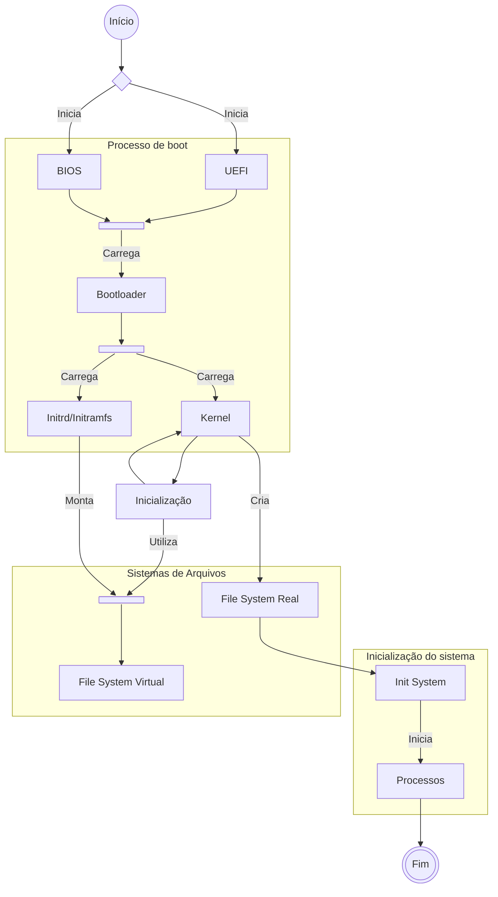

# **Ambiente - LecOS**

Após a inicialização correta do hardware, a responsabilidade da inicialização passa a ser do software daqui para frente, uma vez que ele agora tem a liberdade de executar, já que os componentes da máquina estão funcionando corretamente. O responsável pela próxima etapa é o `bootloader`. No entanto, antes de iniciarmos de fato o tutorial, precisamos subir primeiro o nosso ambiente de desenvolvimento, dessa vez utilizando uma nova distribuição, mais completa e de propósito geral, como base para repassarmos os conceitos fundamentais da disciplina enquanto os realizamos na prática.

---

## **Componentes**

Por se tratar de um sistema mais completo, visando uma melhor didática, teremos alguns componentes a mais na composição, diferentemente da utilização do `BusyBox` na etapa anterior, onde sozinho ele substituía boa parte dos componentes necessários para se utilizar um sistema operacional. Os componentes que utilizaremos são:

* Kernel Linux (64-bit)
* GNU Coreutils
* GNU Bash
* GNU C Library (Glibc)
* GNU Nano
* GNU GRUB (bootloader)
* Ncurses
* Util-Linux
* Systemd

>Todos os componentes do projeto serão detalhados em suas respectivas etapas.

Como mencionado anteriormente, o processo consistirá em passar por cada etapa do funcionamento do sistema operacional, desde o momento de `ligar` o computador até o início de seus processos, visando o entendimento prático dos conceitos e sistemas, em vez de simplesmente aprender a montar um sistema operacional uma segunda vez.

O conteúdo abordado, por ser um pouco mais extenso, será dividido em etapas que englobam os diferentes componentes e conceitos, totalizando 4 módulos presentes no processo com 11 etapas ao todo, sendo eles:

* **Módulo 1 - Início**;
  * BIOS/UEFI;
  * Iniciando o Ambiente;
  * Bootloader;
* **Módulo 2 - Boot**;
  * Kernel;
  * Memória (primária e secundária);
  * Inicialização;
* **Módulo 3 - Processos**;
  * Userland;
  * Init System;
  * Processos;
* **Módulo 4 - Final**;
  * Entrada/Saída;
  * Sistema de Arquivos;
  * Interface gráfica.

---

## **Ambiente**

Assim como na etapa inicial, o trabalho também será desenvolvido dentro de um container `Docker`, visando novamente uma segurança maior para evitar problemas no sistema principal. No entanto, em vez de iniciarmos tudo manualmente através de comandos simples, contaremos com um script de inicialização completo do ambiente, buscando um desenvolvimento mais dinâmico e direto ao ponto, uma vez que já passamos pelo conceito e pelo processo de compilação nos primeiros passos, além de garantir uma boa reprodutibilidade.

<div align="center">


</div>

>Imagem 1: Mensagem de boas-vindas ao executar o script de construção do ambiente.

Além disso, nesse ambiente há persistência de dados graças ao volume construído junto do container, ou seja, você pode pausar o processo e retornar quando quiser, não sendo necessário fazer tudo de uma só vez, evitando perda de progresso e permitindo seguir no próprio ritmo.

>Ao desligar o computador, o container será parado, mas o seu progresso permanece salvo no volume criado. Para retornar ao ambiente, execute `docker restart LecOS-dev` e, para entrar novamente, `docker exec -it LecOS-dev bash`.

<div align="center">


</div>

>Imagem 2: "Take a break" - Faça uma pausa. O sistema permite que você pare quando quiser e retome de onde parou.

---

## **Fluxo**

Com nosso objetivo bem definido, não ficaremos presos somente aos componentes que iremos montar, mas também repassaremos conceitos fundamentais dos sistemas operacionais, o que inclui o hardware que executa o sistema. Com isso, seguindo todas as etapas presentes, temos o seguinte fluxo:


>Diagrama 1: Fluxo de inicialização de uma máquina, iniciando pelo `BIOS/UEFI` e finalizando na inicialização dos processos.

---

## **Inicialização do ambiente**

Para iniciarmos o nosso trabalho, precisamos criar o nosso ambiente de desenvolvimento. Para isso, utilizaremos o script mencionado, o `init.sh`. Esse script contém os comandos necessários para a inicialização do container onde seguiremos o framework, automatizando o processo de criação e já fornecendo todas as ferramentas de que precisaremos para realizar essa tarefa.

No entanto, antes de tudo, precisaremos clonar o repositório do projeto, uma vez que ele contém todos os arquivos necessários para a inicialização do ambiente. Por isso, certifique-se de que seu dispositivo possui o `Git` — o sistema de versionamento de código mais utilizado nos projetos modernos — e execute o seguinte comando:

```bash
# Comando clona o repositório do GitHub para sua máquina local
git clone --depth 1 https://github.com/FelpzzzEX/LecOS.git
```


>Imagem 3: Comando `git` sendo executado e o resultado de sua execução.

Para executarmos o script, precisamos primeiro conceder a ele a permissão de execução, pois, mesmo depois de criado, ele não possui por padrão a capacidade de rodar os comandos sem essa permissão. Portanto, acessando o diretório [Sistema Principal](Sistema_Principal), inserimos os seguintes comandos:

```bash
# Acessa o diretório 'Sistema_Principal'
cd LecOS/Sistema_Principal

# Fornece a permissão de execução (+x) para o script 'init.sh'
chmod +x init.sh
```

Esse comando, basicamente, torna o script `init.sh` executável para o nosso sistema, possibilitando subir todo o ambiente com apenas essa instrução e deixando o _setup_ mais prático e rápido — não estamos aprendendo a subir o ambiente novamente (visto que já fizemos isso na base inicial), mas sim a entender os conceitos de sistemas operacionais enquanto montamos um sistema neste ambiente.

Após fornecer a permissão ao script, podemos, enfim, iniciar nosso trabalho. Ainda dentro do diretório `Sistema_Principal`, executaremos:

```bash
./init.sh
```

Esse script nada mais é que uma sequência de comandos de terminal que são executados automaticamente. Ao executá-lo, ele roda os comandos necessários que foram configurados para deixar nosso ambiente de trabalho pronto para utilização. Abaixo seguem exemplos desses comandos.

>**ATENÇÃO**: Não é necessário executar os comandos abaixo, pois o script já realizará a tarefa automaticamente; eles estão presentes somente por curiosidade.

```bash
# Cria um volume para persistência de dados
# (Pode pausar quando necessário sem perder o progresso)
docker volume create lecos_data

# Cria o container de trabalho "LecOS-dev"
# Utiliza a imagem "lecos" criada para este propósito
docker run -d --name LecOS-dev --privileged -v lecos_data:/LOS felpzzex/lecos:latest tail -f /dev/null
```

Por fim, o script também copia arquivos essenciais para dentro do nosso ambiente, como o `kernel Linux` previamente compilado, o arquivo de inicialização do sistema e os scripts de build para cada componente da nossa userland, apresentados na seção `Componentes`. Caso esteja interessado, você pode verificar o conteúdo completo do script acessando o arquivo [init.sh](../init.sh).

<div align="center">


</div>

>Imagem 4: Conteúdo copiado do sistema principal para dentro do container, contendo todos os scripts de build dos componentes.

Após a execução do script, ele levará você para dentro do container de desenvolvimento do framework, onde iremos montar a distribuição mínima enquanto nos aprofundamos nos conceitos fundamentais de um S.O. As próximas etapas passarão por cada componente presente em nosso planejamento de forma aprofundada e dedicada, seguindo uma "ordem cronológica" do processo de inicialização, na qual já abordamos o início com o `BIOS` e o `UEFI` e, na próxima etapa, começaremos pelo [bootloader](2-Bootloader.md), o responsável por carregar os componentes necessários para a inicialização.