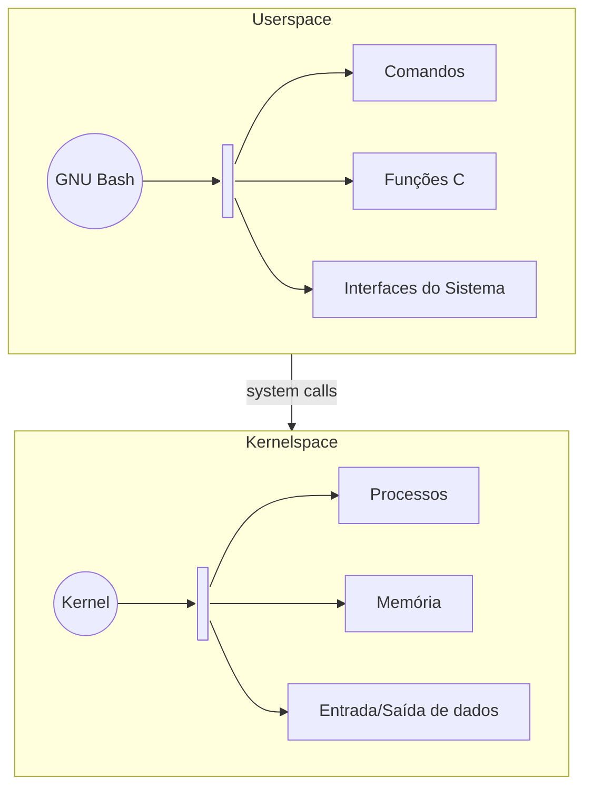

# **Userland**

Após construirmos nossa base, temos enfim uma `userland` utilizável e completa. No entanto, ainda existem configurações a serem feitas para que o sistema se aproxime de uma distribuição GNU/Linux convencional. Além disso, podemos agora observar como os componentes presentes na userland interagem com o sistema para realizar suas tarefas.

Neste módulo, estudaremos a **Userland (Userspace)** e os **Processos**, observando a divisão entre userland e kernelspace, a execução de programas e a comunicação entre eles por meio das interfaces oferecidas pelo kernel. Também utilizaremos alguns trechos de código em C para visualizar, de forma didática, como essa comunicação acontece.

## **A Userland**

A `Userland` (ou `Userspace`) é a região do sistema onde são executados os programas que não fazem parte diretamente do núcleo do sistema operacional. Nela encontramos desde aplicações utilizadas diretamente pelo usuário, como navegadores e editores de texto, até componentes fundamentais para o funcionamento do sistema, como o **GNU Bash**, **GNU Coreutils**, **GNU Nano** e sistemas de inicialização.

Esses programas não precisam acessar diretamente o hardware para realizar suas tarefas. Em vez disso, utilizam interfaces fornecidas pelo kernel, principalmente por meio das `system calls` (**chamadas de sistema**).

## **Userland e Kernelspace**

A separação entre Userland e Kernelspace existe principalmente para fornecer isolamento e controle de acesso. Programas comuns executados na userland não possuem acesso irrestrito à memória, ao hardware ou aos recursos internos do kernel.

Quando um programa precisa realizar uma operação que depende do kernel, como abrir um arquivo, criar um processo ou escrever em um dispositivo, ele solicita essa operação por meio de uma **system call**.

<div align="center">


</div>

## **O Kernelspace**

O Kernelspace é a região privilegiada onde o kernel é executado. Diferentemente dos programas comuns da userland, o kernel possui acesso privilegiado aos recursos do computador e é responsável por gerenciar elementos como memória, processos, dispositivos e sistemas de arquivos.

A userland não acessa esses recursos diretamente. Ela solicita ao kernel que realize determinadas operações em seu nome.

É importante observar que Userland e Kernelspace não são dois sistemas diferentes. Eles são dois espaços de execução com diferentes níveis de privilégio dentro do mesmo sistema.

## **As System Calls**

As `system calls` (ou **syscalls**) são uma das principais formas de comunicação entre a userland e o kernel. Por meio delas, programas podem solicitar serviços que somente o kernel pode executar.

Por exemplo, um programa em **C** pode utilizar `write()` para solicitar ao kernel que escreva dados em um arquivo ou em outro descritor de arquivo:

```c
#include <unistd.h>

int main(void)
{
    write(1, "Ola, usuario!\n", 12);
    return 0;
}
```

Nesse exemplo, o número `1` representa o `stdout`. O programa está na userland, mas a operação de escrita é realizada através de uma interface fornecida pelo kernel.

Essa ideia será importante para compreender como componentes maiores, como o Bash e o Coreutils, conseguem interagir com o sistema.

## **Componentes**

Sabendo o objetivo da separação dos espaços do kernel e do usuário, podemos ver alguns trechos de códigos que componentes do nosso sistema operacional utilizam, de forma a verificar como estes comunicam com o kernel para realizarem suas operações.

### **GNU Bash**

O **GNU Bash** é um dos principais componentes da nossa `userland`. Ele é executado como um processo em `userspace` e fornece uma interface para que o usuário possa executar comandos e interagir com o sistema.

O código-fonte do Bash mostra claramente que ele é um programa comum em C, possuindo uma função `main()` como ponto de entrada da aplicação.
Embora o Bash esteja na userland, muitas das operações que ele realiza dependem de recursos controlados pelo kernel. Para isso, ele utiliza interfaces fornecidas pelo sistema, como as funções da biblioteca C e as `system calls`.

Um exemplo pode ser encontrado na inicialização do próprio Bash. O código verifica se suas entradas padrão estão associadas a um terminal utilizando `isatty()`:

```c
if (forced_interactive ||
    (!command_execution_string &&
     wordexp_only == 0 &&
     ((arg_index == argc) ||
      read_from_stdin) &&
     isatty (fileno (stdin)) &&
     isatty (fileno (stderr))))
  init_interactive ();
else
  init_noninteractive ();
```

Nesse trecho, `fileno(stdin)` obtém o descritor associado à entrada padrão, enquanto `isatty()` verifica se esse descritor está associado a um terminal. Dessa forma, o Bash consegue determinar, por exemplo, se está sendo executado de maneira interativa em um terminal ou de forma não interativa.

Outro exemplo aparece quando o Bash precisa abrir um script:

```c
fd = open (filename, O_RDONLY);
```

A função `open()` solicita a abertura do arquivo e retorna um **file descriptor**, que é um identificador utilizado pelo processo para acessar aquele recurso. É por meio desses descritores que processos trabalham com arquivos, terminais e outros recursos do sistema.

Os três descritores padrão são:

```text
0 → stdin   → entrada padrão
1 → stdout  → saída padrão
2 → stderr  → saída de erro
```

Assim, podemos visualizar de maneira simplificada o funcionamento:



> Diagrama 1: Fluxo da comunicação do GNU Bash (userland) com o kernelspace.

É importante observar que funções como `open()` e `isatty()` não devem ser entendidas necessariamente como as próprias `system calls`. Elas são interfaces utilizadas pelo programa e podem, internamente, realizar chamadas ao kernel quando precisam de serviços que somente ele pode fornecer.

Dessa forma, o Bash é um bom exemplo para compreender a relação entre `userland` e `kernelspace`: O programa é executado no espaço do usuário, mas utiliza as interfaces do sistema para solicitar ao kernel operações sobre os recursos que ele administra.

> **NOTA**: Em caso de curiosidade, o código fonte principal do **GNU Bash** está disponível no diretório `Componentes_Principais`, dentro de `Codigo-Fonte` como `shell.c`.

## **Configurando a Userland**

No entanto, como podemos já observar durante a execução de nosso sistema, nossa `userland` ainda parece um pouco incompleta. Isso se deve ao fato de ainda termos um sistema "cru", sem um usuário criado, somente com o **Bash** atuando como o processo principal (**PID 1**).

Visando isso, estaremos configurando agora os usuários e realizando todas as demais configurações necessárias para dar uma vida a mais para o nosso sistema, visando uma usabilidade e entendimento melhor das suas utilidades.

Antes de prosseguir, dentro de nosso contêiner, devemos montar a imagem novamente para estarmos fazendo os ajustes necessários:

```bash
# Montamos novamente a imagem em /mnt
mknod /dev/loop0 b 7 0
losetup -fP --show lecos.img
kpartx -av /dev/loop0
mount /dev/mapper/loop0p1 /mnt
```

### **Compilando dependências necessárias**

Para seguirmos com nossa configuração da userland, precisaremos inserir mais alguns componentes que irão permitir seu funcionamento como queremos, sendo eles o `Shadow-Utils`, o `Linux-PAM` e o `Libxcrypt`, todos sendo utilizados na tarefa de criar um usuário em nosso sistema. Logo abaixo estaremos nos aprofundando nesses componentes enquanto os instalamos em nosso sistema, seguindo o mesmo padrão do que já fizemos até aqui.

Os links para encontrar e baixar os componentes se encontram no próprio texto, a partir deles, estaremos fazendo o `wget` para baixar dentro de nosso contêiner de desenvolvimento e, em seguida, realizar o processo de compilação e instalação através dos scripts de build, mas dessa vez, será com vocês!

#### **GNU Inetutils**

O GNU Inetutils é uma coleção de programas relacionados à comunicação e às funções básicas de rede em sistemas GNU/Linux. Entre suas ferramentas está o `hostname`, utilizado para consultar ou definir o nome atribuído ao sistema.

No nosso caso, não precisamos utilizar todos os programas fornecidos pelo pacote. O objetivo desta etapa é principalmente disponibilizar o comando `hostname`, permitindo que o LecOS tenha uma identificação própria durante sua execução.

O GNU Inetutils pode ser encontrado [neste link](https://ftp.gnu.org/gnu/inetutils/).

#### **Shadow-Utils**

O Shadow-Utils fornece ferramentas responsáveis pelo gerenciamento de usuários e grupos do sistema, como `useradd`, `groupadd` e `passwd`. Esses programas permitem criar identidades no sistema e manter informações relacionadas a elas, utilizando arquivos como `/etc/passwd`, `/etc/group` e `/etc/shadow`.

No nosso sistema, ele será utilizado principalmente para criar e configurar o usuário `root`, podendo ser encontrado [neste link](https://github.com/shadow-maint/shadow/releases?page=2#release-4.17.4).

#### **Linux-PAM**

O **Linux-PAM (Pluggable Authentication Modules)** fornece uma estrutura para que aplicações possam utilizar mecanismos de autenticação de forma modular. Em vez de cada programa implementar sozinho todo o processo de autenticação, ele pode utilizar o PAM para consultar e aplicar as regras de autenticação configuradas no sistema.

No nosso caso, o PAM participa da infraestrutura utilizada por ferramentas relacionadas à autenticação e gerenciamento de usuários, podendo ser encontrada a versão 1.7.0 [neste link](https://github.com/linux-pam/linux-pam/releases#release-v1.7.0).

#### **Libxcrypt**

A Libxcrypt fornece funções relacionadas à geração e verificação de hashes criptográficos utilizados para armazenar senhas de forma segura. Ela é utilizada por componentes de gerenciamento de usuários para transformar uma senha em um valor que pode ser armazenado no `/etc/shadow`, sem precisar guardar a senha original.

Assim, quando utilizamos o `passwd`, a senha fornecida pode ser processada pela Libxcrypt antes de seu armazenamento no sistema. A versão 4.5.2 da Libxcrypt pode ser encontrada [neste link](https://github.com/besser82/libxcrypt/releases).

#### **Finalizando a instalação**

Após tudo compilado e instalado em nosso contêiner, basta colocarmos tudo dentro de nossa imagem montada novamente, bastando apagar os diretórios presentes (com exceção de `/boot`) e adicionar a nova estrutura de diretórios dentro:

```bash
# Deleta a estrutura antiga
rm -rf /mnt/{bin,dev,etc,lib,lib64,proc,sbin,sys,usr,var}

# Adiciona a estrutura nova 
cp -R root/* /mnt
```

Após isso, podemos sincronizar e desmontar a imagem mais uma vez, gerando nossa nova imagem bootável:

```bash
# Sincronize as alterações
sync

# Desmonta 'lecos.img' de '/mnt' e remoção do loop device
umount /mnt
kpartx -d /dev/loop0
losetup -d /dev/loop0
```

Em seguida, em nosso sistema principal, salve a imagem antiga que copiamos na etapa anterior para termos um backup. Em seguida, copie a nova imagem que geramos dentro do contêiner para o diretório atual em seu sistema e, após isso, execute com o **QEMU**:

```bash
# Copia 'lecos.img' para o diretório atual
docker cp [ID_CONTAINER]:/LOS/lecos.img .

# Executa o sistema
qemu-system-x86_64 lecos.img 
```

### **Identificando o Sistema e Usuário**

Ao inicializarmos o Bash diretamente no PID 1, podemos notar que o sistema opera sem uma base formal de usuários configurada. Internamente, o kernel do Linux não gerencia nomes textuais, mas sim identificadores numéricos chamados **UIDs** (User IDs) e **GIDs** (Group IDs). O primeiro processo do sistema executa sob o privilégio máximo: **UID 0**.

A tradução desse identificador numérico para um nome legível em texto é uma responsabilidade exclusiva da `userland`, realizada por meio de bibliotecas do runtime C (através de funções como `getpwuid()`) que consultam arquivos locais do sistema:

1. `/etc/passwd`: contém o mapeamento de UIDs para nomes de usuário, shell padrão e diretório home.

2. `/etc/group`: define os grupos do sistema e seus respectivos GIDs.

3. `/etc/shadow`: armazena os hashes das senhas e regras de expiração de acesso.

Caso esse mapeamento não exista, ferramentas de espaço de usuário não conseguirão resolver o UID 0, exibindo frequentemente mensagens informativas como `I have no name!`.

Para estabelecer a identidade básica de superusuário (root), criamos as entradas mínimas nos arquivos de configuração:

```bash
# Registra o superusuário (UID 0, GID 0) com shell /bin/bash e home /root
echo "root:x:0:0:root:/root:/bin/bash" > /etc/passwd

# Registra o grupo primário root (GID 0)
echo "root:x:0:" > /etc/group
```

O campo `x` presente em `/etc/passwd` indica que a senha não está armazenada nesse arquivo. Em sistemas que utilizam o mecanismo tradicional de autenticação por senha, seu hash é armazenado separadamente em `/etc/shadow`.

> O formato do arquivo é composto por `usuário:senha:UID:GID:nome:home:shell`, onde **usuário** é o nome principal, **UID** e **GID** o identificador do usuário (0 é o superusuário), **nome** é o nome real do usuário, **home** é o diretório pessoal do usuário e **shell** sendo o shell padrão do usuário, em nosso caso, somente o GNU Bash.

Com a criação do usuário `root` e do seu respectivo grupo, teremos um resultado com uma estrutura semelhante a seguinte:

```text
/etc/passwd
└── root:x:0:0:root:/root:/bin/bash

/etc/group
└── root:x:0:
```

Enquanto o `/etc/passwd` identifica os usuários e seus respectivos UIDs, o `/etc/shadow` armazenará os hashes das senhas. Dessa forma, a senha em si não precisa ser armazenada diretamente no sistema de arquivos.

> Não criaremos a senha do usuário root ainda, uma vez que o componente responsável por isso necessita do `Systemd`, o init-system que compilaremos na etapa seguinte, esteja funcionando e assuma o "posto" de **PID 1**.

### **Rastreando diretórios**

Outro ponto imediatamente perceptível na experiência interativa do shell é o indicador da linha de comando (prompt). Em uma distribuição comum, o terminal normalmente indica o usuário conectado, o nome da máquina e o caminho em que você está navegando:

```shell
usuario@hostname:~/diretório$
```

No entanto, no nosso sistema recém-construído, independente do diretório acessado com o comando `cd`, o prompt permanece estático como:

```shell
bash-5.2#
```

Isso ocorre porque o Bash consulta a variável de ambiente `PS1` (Prompt String 1) a cada iteração do seu loop interativo (REPL - Read-Eval-Print Loop). Se nenhuma variável `PS1` for definida no ambiente, o shell utiliza o seu padrão interno de compilação `\s-\v\$`, que exibe:

* **\s-**: o nome do shell
* **\v**: a versão do shell
* **$**: o caractere `#` ou `$`, dependendo do UID

O Bash oferece uma série de sequências de escape que permitem construir um prompt dinâmico e contextual:

* `\u`: expande para o nome do usuário associado ao UID atual (consultando o `/etc/passwd`).
* `\h`: expande para o hostname da máquina até o primeiro ponto (consultando o kernel).
* `\w`: expande para o caminho completo do diretório de trabalho atual, abreviando o diretório pessoal por `~`.
* `\W`: expande apenas para o nome base do diretório atual.
* `\$`: avalia dinamicamente se o usuário logado possui privilégios de superusuário (exibindo `#` para **UID 0** e `$` para os demais usuários).

Para que essas variáveis de ambiente e o caminho dos binários do sistema (`PATH`) sejam inicializados automaticamente em cada nova sessão interativa de login (como do usuário `root` que acabamos de criar), precisamos criar e salvar a configuração no arquivo `/etc/profile`. 

Para isso, primeiro precisamos criar o nome do nosso sistema (o `hostname`). Para isso, basta rodar o seguinte comando:

```bash
# Dá o nome ao host da máquina
hostname [nome-do-sistema]
```

Em seguida, para finalizar a configuração do **PS1** do nosso usuário `root`, executamos o seguinte comando, o qual o shell pegará todo o texto (`cat`) antes de **EOF** (_End of File_) e jogará em `/etc/profile`:

```bash
cat << 'EOF' > /etc/profile
export PATH=/usr/local/bin:/usr/bin:/bin:/usr/local/sbin:/usr/sbin:/sbin
export PS1='\u@\h:\w\$ '
EOF
```

Dessa forma, o shell em espaço de usuário ganha contexto sobre a navegação no sistema de arquivos, a identidade da máquina e as permissões ativas.

Faça o teste, dentro do sistema rodando no QEMU, insira no terminal:

```bash
su - root
```

Se tudo foi feito corretamente, você verá a seguinte entrada ao logar como root:

```
root@[nome-do-sistema]:/#
```

<div align="center">


</div>

Imagem 2:

No entanto, embora o hostname esteja funcionando agora, da maneira que fizemos ele assume um estado volátil -- ele só se mantém em tempo de execução, pois se encerramos e abrimos nosso sistema, ele perde o valor setado. Essa questão será resolvida com a utilização do init-system `Systemd`, o qual carregará automaticamente o hostname.

## **Próximos Passos**

Após as configurações serem feitas, estaremos passando para o `init-system`, componente essencial que cuidará dos processos existentes em nosso sistema, sendo o escolhido para o framework o `Systemd`, sistema amplamente utilizado em diversas distribuições GNU/Linux do mercado, como o Debian, Fedora, Arch Linux, Ubuntu, dentre outras. Continue o bom trabalho, estamos caminhando para a finalização!