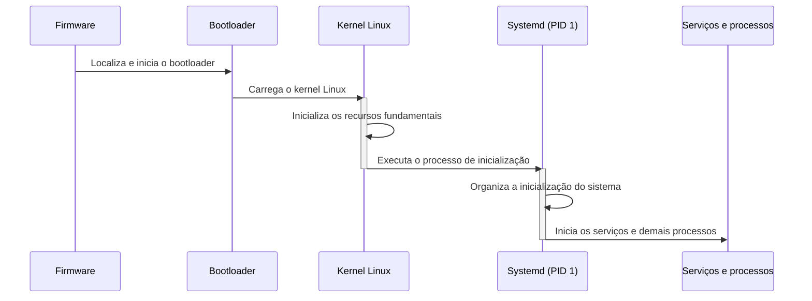
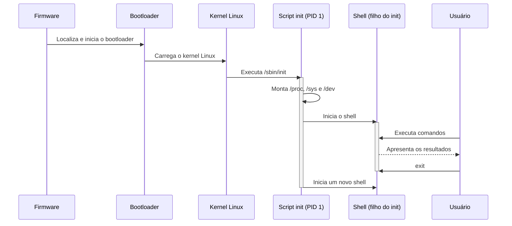
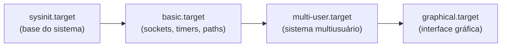
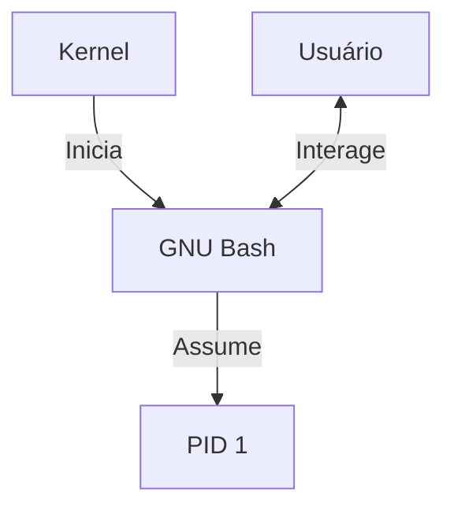
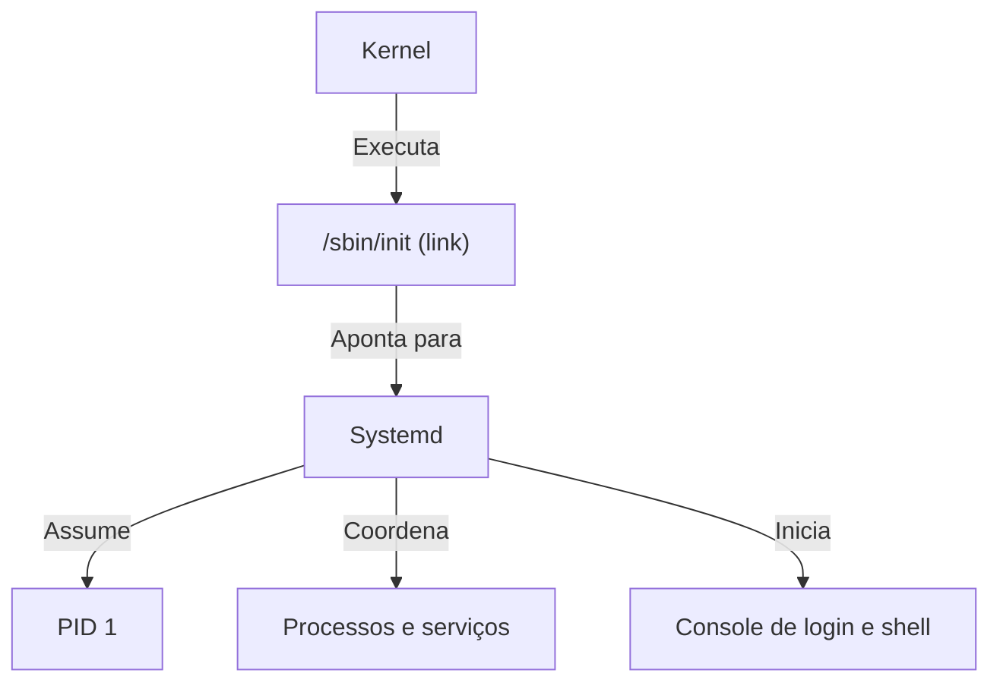

# **Init System**

Após termos construído nossa `userland`, chegou o momento de substituir o **Bash**, que até então estava atuando como **PID 1**, por um sistema de inicialização próprio. Para isso, utilizaremos o **Systemd**.

O Systemd será responsável por assumir o papel de processo principal do sistema, coordenando a inicialização do sistema e o gerenciamento dos serviços e processos necessários durante seu funcionamento.

Diferentemente do estágio anterior, no qual o Bash era iniciado diretamente pelo kernel e permanecia como o processo principal, agora teremos uma estrutura de inicialização mais próxima daquela encontrada em distribuições GNU/Linux convencionais.

## **Sobre o Init System**

O `init-system` é o componente responsável por iniciar e organizar o ambiente de espaço de usuário após a etapa inicial de inicialização do kernel.

Durante o boot, o bootloader carrega o kernel Linux, que inicializa os recursos fundamentais do sistema e prepara o ambiente necessário para executar o primeiro processo em espaço de usuário. Esse processo recebe o identificador **PID 1** e assume um papel central na inicialização do restante do sistema.

No nosso sistema, utilizaremos o Systemd para ocupar essa posição.



> Diagrama 1: Sequência simplificada do processo de inicialização do sistema utilizando o Systemd.

Já no estágio anterior, essa posição era ocupada pelo nosso script `init`, interpretado pelo **Bash**: ele montava os sistemas de arquivos virtuais e mantinha um shell em execução, reiniciando-o sempre que o usuário saía:



> Diagrama 2: Funcionamento simplificado da etapa anterior, com o script `init` como PID 1 e o shell como seu processo filho.

Essa abordagem foi suficiente para demonstrar a relação entre o kernel e o espaço de usuário, permitindo executar comandos e interagir com o sistema. Entretanto, ela não oferece, por si só, os mecanismos necessários para organizar a inicialização de um sistema mais completo.

Um `init-system` deve, entre outras funções, iniciar processos, coordenar serviços, acompanhar seu funcionamento e participar das operações de desligamento e reinicialização da máquina.

É justamente nesse papel que entra o Systemd.

## **O que o PID 1 precisa fazer?**

O PID 1 não é um processo comum. Além de ser o ancestral de todos os outros, ele carrega responsabilidades que nenhum outro programa possui:

* **Preparar o espaço de usuário**: montar os sistemas de arquivos virtuais, preparar diretórios de execução e iniciar os serviços na ordem correta.
* **Supervisionar os serviços**: saber se um serviço terminou ou falhou e, quando configurado, iniciá-lo novamente.
* **Adotar processos órfãos e recolher zumbis**: quando um processo termina, seu pai precisa recolher o seu estado; se o pai terminar antes do filho, o filho fica órfão e é adotado pelo PID 1, que passa a ser responsável por recolher esse estado (veremos isso na prática na próxima etapa).
* **Conduzir o desligamento**: encerrar os serviços de forma ordenada, desmontar os sistemas de arquivos e só então pedir ao kernel que desligue ou reinicie a máquina.

Além disso, como vimos nas etapas anteriores, o kernel não tolera a ausência desse processo: se o PID 1 terminar, o resultado é um **kernel panic**.

Nosso script `init` cumpria apenas uma pequena parte dessas tarefas. Comparando com o que o Systemd passa a fazer:

<div align="center">

| **Tarefa** | **Script `init` (etapa anterior)** | **Systemd** |
| :--: | :--: | :--: |
| Montar `/proc`, `/sys` e `/dev` | Comandos `mount` escritos manualmente no script | Montados automaticamente nas fases iniciais do boot |
| Manter o console disponível | Laço `while true` que reinicia o Bash | Serviço de login no console, reiniciado quando termina |
| Ordem de inicialização | Sequência fixa de linhas do script | Dependências entre units, resolvidas pelo Systemd |
| Acompanhar falhas | Nenhum acompanhamento | Estado de cada unit (`systemctl --failed`) |
| Desligar e reiniciar | Sem mecanismo próprio | `systemctl poweroff` e `systemctl reboot` |

</div>

>Tabela 1: Comparativo entre o script `init` da etapa anterior e o Systemd.

### **Um pouco de história**

Durante muitos anos, o padrão em sistemas GNU/Linux foi o **SysVinit**, herdado dos Unix tradicionais. Nele, a inicialização executa uma sequência de scripts de shell (geralmente em `/etc/init.d`), organizados em níveis de execução (*runlevels*). É um modelo simples e fácil de entender, mas que executa os serviços um após o outro e não acompanha o que acontece com eles depois de iniciados.

O **Systemd** surgiu para resolver essas limitações, iniciando serviços em paralelo, controlando suas dependências e supervisionando-os durante toda a execução. Hoje, ele é o init padrão de grande parte das distribuições, incluindo o Debian, o Fedora e o Arch Linux que mencionamos na etapa do Kernel. Isso não significa que seja o único: alternativas como o **OpenRC** (Alpine e Gentoo) e o **runit** (Void Linux) seguem em uso, principalmente em sistemas que priorizam a simplicidade.

## **Sobre o Systemd**

O **Systemd** é um sistema de inicialização e gerenciamento de serviços para sistemas GNU/Linux. Ele assume o papel de **PID 1** e fornece mecanismos para inicializar o sistema, gerenciar serviços, organizar dependências entre componentes e controlar operações como desligamento e reinicialização.


> Imagem 1: Logo do Systemd.

Uma das características importantes do Systemd é a utilização de **units**, que representam recursos gerenciados pelo sistema. Entre elas, destacam-se as `service units`, utilizadas para definir e controlar serviços, e as `target units`, utilizadas para agrupar unidades e organizar etapas do processo de inicialização.

Além do processo principal, o projeto fornece ferramentas e componentes auxiliares. Entre eles estão:

- `systemctl`: utilizado para consultar e controlar serviços e outras unidades do Systemd.
- `journalctl`: utilizado para consultar os registros produzidos pelo sistema e por seus serviços, quando o mecanismo de logging correspondente está disponível.
- `systemd-logind`: componente responsável pelo gerenciamento de sessões de usuários, entre outras funções relacionadas.

Para o nosso sistema, o objetivo inicial não é explorar todos esses recursos, mas estabelecer uma base funcional de inicialização que permita executar o Systemd como PID 1 e iniciar os componentes necessários ao funcionamento do sistema.

### **Como o Systemd organiza o sistema**

Em vez de scripts executados em sequência, o Systemd trabalha com **units**: arquivos de configuração que descrevem *o que* deve ser gerenciado e *como* ele se relaciona com o resto do sistema. Os tipos mais comuns são:

* **service**: um serviço, ou seja, um programa que o Systemd inicia e supervisiona;
* **target**: um agrupamento de units que representa uma etapa do boot (ou um "estado" do sistema);
* **mount**: um ponto de montagem de sistema de arquivos;
* **socket** e **timer**: units que iniciam serviços quando chega uma conexão ou quando um horário é atingido.

Uma `service unit` é um arquivo de texto simples. O exemplo abaixo é fictício e simplificado, apenas para visualizarmos sua estrutura:

```ini
[Unit]
Description=Meu serviço de exemplo
After=basic.target

[Service]
ExecStart=/usr/bin/meu-programa
Restart=on-failure

[Install]
WantedBy=multi-user.target
```

* **[Unit]**: descreve a unit e suas relações. O `After=` define *ordem* ("inicie depois de..."), enquanto `Wants=` e `Requires=` definem *dependência* ("puxe esta unit junto" e "só funcione se ela funcionar", respectivamente). São coisas diferentes: ordem e dependência são declaradas separadamente.
* **[Service]**: define o que executar (`ExecStart=`) e o que fazer se o programa terminar (`Restart=`).
* **[Install]**: define em qual target a unit deve ser incluída quando for habilitada. Aqui, `WantedBy=multi-user.target` significa "inicie este serviço quando o sistema alcançar o modo multiusuário".

Como cada unit declara suas próprias dependências, o Systemd monta o "mapa" do boot sozinho e consegue iniciar em paralelo tudo o que não depende uma coisa da outra. Os **targets** funcionam como marcos desse caminho:



> Diagrama 3: Principais targets alcançados durante a inicialização. O Systemd tenta alcançar o `default.target`, que aponta para um deles.

### **Escopo da implementação**

O Systemd oferece diversos recursos e pode ser compilado com diferentes opções e dependências. Por isso, não precisamos habilitar ou instalar indiscriminadamente todos os seus componentes para alcançar nosso objetivo.

Neste framework, priorizaremos uma configuração minimalista, habilitando os recursos necessários à inicialização do sistema e evitando dependências e funcionalidades que não façam parte do escopo atual do projeto.

É importante destacar que **uma compilação bem-sucedida não garante, por si só, que o Systemd conseguirá inicializar o sistema**. Também precisamos garantir que o executável, suas bibliotecas, os diretórios necessários e os recursos disponibilizados pelo kernel estejam corretamente preparados na raiz do sistema (`rootfs`).

Na etapa prática, trabalharemos justamente nessa integração, substituindo o Bash como PID 1 e preparando o ambiente para que o Systemd possa assumir a inicialização do sistema.

Neste framework, utilizaremos a versão **257.13** do Systemd, mantendo uma versão fixa, assim como nos demais componentes, para facilitar a reprodução do processo de construção e reduzir possíveis incompatibilidades entre versões.

## **Instalando e configurando**

A compilação do Systemd depende de ferramentas de desenvolvimento e de bibliotecas que precisam estar disponíveis no ambiente de construção. Para evitar que o aluno tenha de executar manualmente uma longa sequência de comandos, todo esse processo será automatizado pelo script de build preparado para este framework.

O Systemd utiliza o **Meson** como sistema de configuração e o **Ninja** como ferramenta de compilação, diferenciando-se dos demais componentes que vimos no decorrer do trabalho, que utilizam o `make` para essa finalidade. Também utiliza ferramentas como `gperf`, Python e Jinja2 durante o processo de construção. A documentação do próprio projeto lista essas ferramentas entre os requisitos de compilação. 

> Não precisaremos nos preocupar em instalá-las, uma vez que nosso ambiente de desenvolvimento já fornece parte dessas ferramentas, com exceção das que precisam ser baixadas através do `wget` e das que precisam ser instaladas com o `apt-get` (`python3-jinja2` e `gperf`), como veremos a seguir.

O script compila e instala as dependências selecionadas — `libcap 2.75`, `kmod 34.2` e `zstd 1.5.7` — e depois configura, compila e instala o Systemd 257.13. Para isso, como em componentes anteriores, baixaremos os **tarballs** deles através do `wget`, garantindo o código-fonte em nosso ambiente de construção e permitindo que o script execute como esperado.

É necessário baixar as **quatro** fontes (libcap, kmod, zstd e Systemd) **dentro do container**, no diretório `/LOS/Componentes`, o mesmo onde estão os demais componentes. Se algum deles for baixado em outro lugar, ou em outra versão, o script falhará, pois ele procura os diretórios `libcap-2.75`, `kmod-34.2`, `zstd-1.5.7` e `systemd-257.13` nesse local:

<div align="center">

| **Componente** | **Versão** | **Arquivo a baixar** | **Comando para extrair** | **Diretório gerado** |
| :--: | :--: | :--: | :--: | :--: |
| **libcap** | 2.75 | `libcap-2.75.tar.xz` | `tar -xJf libcap-2.75.tar.xz` | `libcap-2.75` |
| **kmod** | 34.2 | `kmod-34.2.tar.xz` | `tar -xJf kmod-34.2.tar.xz` | `kmod-34.2` |
| **zstd** | 1.5.7 | `zstd-1.5.7.tar.gz` | `tar -xzf zstd-1.5.7.tar.gz` | `zstd-1.5.7` |
| **Systemd** | 257.13 | `systemd-257.13.tar.gz` | `tar -xzf systemd-257.13.tar.gz` | `systemd-257.13` |
| **Kernel Linux** | 6.12.108 | `linux-6.12.108.tar.xz` | `tar -xJf linux-6.12.108.tar.xz` | `linux-6.12.108` |

</div>

>Tabela 2: Versões e arquivos que devem estar em `/LOS/Componentes` antes de executar o script.

> **ATENÇÃO**: o código-fonte do Systemd é baixado da página de releases do projeto, na versão `v257.13`. Caso o arquivo baixado tenha outro nome (como `v257.13.tar.gz`), renomeie-o para `systemd-257.13.tar.gz` ou utilize a opção `-O` do `wget`. O importante é que, após a extração, o diretório gerado se chame `systemd-257.13`.

```bash
# Acessamos o diretório dos componentes
cd /LOS/Componentes

# Baixamos as quatro fontes (substitua cada [LINK_...] pelo link do componente)
wget [LINK_LIBCAP]
wget [LINK_KMOD]
wget [LINK_ZSTD]
wget [LINK_SYSTEMD]

# Extraímos os tarballs
tar -xJf libcap-2.75.tar.xz
tar -xJf kmod-34.2.tar.xz
tar -xzf zstd-1.5.7.tar.gz
tar -xzf systemd-257.13.tar.gz
```

Além disso, precisaremos também instalar os `headers do kernel`, uma dependência essencial para o Systemd. O download do Kernel Linux `6.12.108` deve ser feito da mesma forma, **no diretório `/LOS/Componentes`**, pois o diretório `linux-6.12.108` precisa existir ali. Após baixar o tarball com o `wget` e extrair o conteúdo com o comando **tar**, basta rodar os seguintes comandos, na pasta do kernel:

```bash
cd /LOS/Componentes

# Baixamos o kernel (substitua [LINK_KERNEL] pelo link do componente)
wget [LINK_KERNEL]
tar -xJf linux-6.12.108.tar.xz

cd /LOS/Componentes/linux-6.12.108

make ARCH=x86_64 headers_install \
    INSTALL_HDR_PATH="$LOS/usr"
```

> Os headers do kernel Linux são arquivos que contêm definições e declarações das interfaces disponibilizadas pelo kernel, permitindo que programas e bibliotecas do sistema utilizem essas interfaces durante a compilação. Em nosso sistema, eles são necessários para atender às dependências de componentes como o Systemd.

Por fim, o script de build do Systemd depende de duas ferramentas que ainda não estão instaladas no container: o `gperf` e o módulo `jinja2` do Python. Sem elas, a execução do `systemd-build.sh` resultará em erro. Instale-as com:

```bash
apt-get update && apt-get install -y python3-jinja2 gperf
```

Com os componentes baixados e os headers instalados, podemos enfim prosseguir para a compilação e instalação deles, além do próprio **Systemd**. Certifique-se de que os códigos-fonte dos componentes esperados pelo script (libcap, kmod, zstd e Systemd) estejam disponíveis em `/LOS/Componentes`, nas versões indicadas na Tabela 2. Após garantir que todos os componentes estão presentes, execute o script de build do Systemd:

```bash
# Acesse o diretório de scripts 
cd /LOS/Componentes/scripts

# Forneça a permissão de execução e, após, execute o script
chmod +x systemd-build.sh
./systemd-build.sh
```

### **O que o script faz?**

1. **Compila e instala a libcap 2.75.** A biblioteca fornece interfaces para trabalhar com as capacidades do kernel Linux.
2. **Compila e instala o kmod 34.2.** Esse componente disponibiliza ferramentas e a biblioteca `libkmod`, utilizada pelo Systemd quando o suporte a módulos do kernel está habilitado.
3. **Compila e instala o zstd 1.5.7.** Essa biblioteca oferece o algoritmo de compressão Zstandard, habilitado nesta construção do Systemd.
4. **Prepara o ambiente de compilação.** As variáveis `SYSROOT`, `CPPFLAGS`, `CFLAGS`, `CXXFLAGS`, `LDFLAGS` e `PKG_CONFIG_PATH` orientam as ferramentas para encontrar os cabeçalhos e as bibliotecas instalados na rootfs do nosso sistema, em vez de depender inadvertidamente dos arquivos do sistema hospedeiro.
5. **Verifica as dependências.** Antes de compilar o Systemd, o script confirma a presença dos arquivos de desenvolvimento de `libcap`, `libkmod`, `libblkid`, `libmount` e `Linux-PAM`. Também verifica se o `pkg-config` reconhece a `libkmod`.
6. **Configura o Systemd com Meson.** As opções selecionadas habilitam funcionalidades necessárias ou úteis ao projeto e desabilitam outras que estão fora do escopo atual.
7. **Compila e instala o Systemd.** O Meson configura o projeto, compila os componentes e instala os arquivos dentro de `$LOS`, sem direcionar a instalação à raiz do sistema hospedeiro.

Se uma verificação falhar, o script é interrompido para evitar que a compilação continue sobre uma base incompleta.

### **Por que usamos um SYSROOT?**

Durante a compilação de uma distribuição, o sistema hospedeiro e o sistema que está sendo construído são ambientes diferentes. O hospedeiro fornece o compilador e as ferramentas de build; a rootfs do nosso sistema contém os cabeçalhos e as bibliotecas destinados ao sistema final.

O `SYSROOT` e as variáveis de compilação ajudam a separar esses ambientes. Já `DESTDIR="$LOS"` direciona a instalação dos arquivos para a árvore do nosso sistema.

Essa distinção é importante: compilar um programa usando bibliotecas do hospedeiro por engano pode produzir um executável que não funcione corretamente dentro da imagem final.

### **Quais funcionalidades foram selecionadas?**

A configuração do script não habilita todos os recursos disponíveis no Systemd. Entre as decisões mais importantes estão:

- `sysusers` e `tmpfiles` são habilitados para disponibilizar ferramentas de criação de contas de sistema e gerenciamento de arquivos temporários.
- O suporte a PAM é habilitado, aproveitando o Linux-PAM construído anteriormente.
- O suporte a `kmod` e `blkid` é habilitado para integrar o Systemd às bibliotecas correspondentes.
- O suporte a Zstandard é habilitado, enquanto zlib, XZ e LZ4 são desabilitados nesta construção.
- Recursos como `systemd-resolved`, `systemd-networkd`, `systemd-homed`, `systemd-machined`, `systemd-portabled`, `systemd-timesyncd`, `systemd-coredump` e outros componentes opcionais são desabilitados ou mantidos fora do escopo atual.
- A geração de páginas de manual e documentação HTML é desabilitada para evitar trabalho e dependências desnecessárias nesta etapa.

### **Tornando o Systemd o PID 1**

Ao final, o script apresenta verificações da instalação, incluindo o executável principal do Systemd, o `systemd-logind`, as ferramentas `systemd-sysusers` e `systemd-tmpfiles`, além de uma amostra das unidades instaladas.

Essas verificações confirmam que os arquivos esperados foram instalados na rootfs. A presença de um executável, contudo, não garante por si só que todas as suas dependências de execução estejam disponíveis.

O executável principal será instalado em:

```text
/usr/lib/systemd/systemd
```

Para que o kernel possa encontrá-lo pelo caminho convencional de inicialização, criamos o link `init` na rootfs:

```bash
ln -sf /usr/lib/systemd/systemd "$LOS/sbin/init"
```

> O caminho `/sbin/init` é o mesmo onde colocamos o nosso script na etapa anterior. Como a opção `-f` (*force*) sobrescreve o arquivo existente, **o link passa a substituir o script**: o kernel agora executa o Systemd diretamente, sem intermediários.

Tendo tudo pronto, podemos enfim configurar o `Systemd` para atuar como **PID 1** do nosso sistema. Para isso, foi preparado o script `systemd-setup.sh`, o qual cuidará de todo o processo de configuração dele em nosso ambiente de desenvolvimento. Dê as `permissões` necessárias para executá-lo e, no diretório de scripts, insira o comando:

```bash
# Forneça as permissões de execução e, em seguida, execute
chmod +x systemd-setup.sh
./systemd-setup.sh
```

Esse script, basicamente:

* Cria os usuários e grupos de sistema necessários, utilizando o systemd-sysusers
* Configura o acesso ao terminal virtual tty1, permitindo o login pelo console
* Baixa, compila e instala o kbd, ferramenta responsável pelo gerenciamento do teclado no Linux
* Configura o layout de teclado brasileiro ABNT2, incluindo um mapa de teclado descompactado para garantir seu carregamento correto durante a inicialização
* Realiza verificações básicas para confirmar que os arquivos e as configurações necessárias foram criados

Também podemos criar os links tradicionais para os comandos de controle do sistema, caso ainda não existam:

```bash
ln -sf ../bin/systemctl "$LOS/sbin/reboot"
ln -sf ../bin/systemctl "$LOS/sbin/poweroff"
ln -sf ../bin/systemctl "$LOS/sbin/halt"
ln -sf ../bin/systemctl "$LOS/sbin/shutdown"
ln -sf ../bin/systemctl "$LOS/sbin/telinit"

# Sincroniza as alterações
sync
```

Esses comandos são configurações posteriores à execução do script de build. Eles não recompilam o Systemd; apenas definem os caminhos tradicionais para inicialização e controle do sistema.

O resultado esperado para o link principal é semelhante a:

```text
/sbin/init -> /usr/lib/systemd/systemd
```

Quando o kernel iniciar o sistema, esse caminho permitirá que o Systemd seja executado como **PID 1**.

## **Após a instalação**

O Systemd utiliza algumas informações básicas para identificar a instalação. Podemos definir um hostname persistente. Dentro do nosso ambiente de desenvolvimento, inserimos o nome do sistema no arquivo `hostname`:

```bash
echo "[NOME-DO-SISTEMA]" > "$LOS/etc/hostname"
```

> **ATENÇÃO**: Substitua `[NOME-DO-SISTEMA]` pelo nome do seu sistema, o mesmo definido nas etapas anteriores.

Tendo o hostname definido, podemos seguir para a criação de um arquivo simples de identificação da distribuição, muito comum em diversos sistemas GNU/Linux. Para isso, inseriremos o seguinte comando:

```bash
cat > "$LOS/etc/os-release" <<'EOF'
NAME="[NOME-DO-SISTEMA]"
VERSION="1.0"
ID=[ID-DO-SISTEMA]
PRETTY_NAME="[NOME COMPLETO DO SISTEMA]"
EOF
```

O `/etc/hostname` define o nome persistente da máquina, enquanto `/etc/os-release` permite que ferramentas identifiquem a distribuição.

> **ATENÇÃO**: Substitua `[NOME-DO-SISTEMA]` pelo nome do seu sistema, `[ID-DO-SISTEMA]` por um identificador curto, em letras minúsculas e sem espaços (por exemplo, o nome do sistema em minúsculas), e `[NOME COMPLETO DO SISTEMA]` pelo nome completo da sua distribuição.

Também precisamos criar o identificador único da instalação através da criação de `/etc/machine-id`, que faz parte da preparação de uma instalação Systemd. Essa etapa deve ser feita no ambiente alvo, quando a ferramenta correspondente estiver disponível e puder ser executada corretamente. Para isso, utilizaremos o `chroot`:

```bash
chroot "$LOS" /usr/bin/systemd-machine-id-setup
```

Esse comando cria `/etc/machine-id`, que é utilizado pelo Systemd para identificar de forma única a instalação do sistema. O Linux From Scratch (LFS) também realiza essa etapa após a instalação do Systemd.

Porém, para que o Systemd trate o primeiro boot como uma instalação nova e peça a criação da senha do root, precisamos de dois ajustes adicionais. Sem eles, o sistema irá direto para a tela de login pedindo uma senha que nunca foi criada, deixando-o impossível de utilizar. Primeiro, gravamos o valor `uninitialized` em `/etc/machine-id`:

```bash
echo "uninitialized" > "$LOS/etc/machine-id"
```

O valor `uninitialized` faz o Systemd tratar o boot como o **primeiro boot**: ele gera o identificador definitivo e executa os serviços de configuração inicial, como o `systemd-firstboot`.

Em seguida, removemos o arquivo `/etc/shadow`, para que o sistema solicite o cadastro da senha no primeiro acesso:

```bash
rm -f "$LOS/etc/shadow"

# Sincroniza as alterações
sync
```

> Essa remoção **precisa vir depois da execução do `systemd-setup.sh`**. Isso porque o `shadow-build.sh` (etapa anterior) cria o arquivo vazio e o `systemd-sysusers`, executado pelo setup, grava nele as entradas dos usuários de sistema. Esses usuários ficam sem linha no `shadow`, o que não causa problema, pois essas contas não devem fazer login.

> **Change root** (`chroot`): comando que altera temporariamente o diretório raiz (`/`) de um processo, fazendo com que ele enxergue um diretório específico como a raiz do sistema. Isso permite executar ferramentas dentro do ambiente alvo do nosso sistema, utilizando os arquivos e as configurações desse sistema, em vez dos arquivos do sistema hospedeiro.

Feito tudo isso, podemos enfim adicionar os novos componentes ao nosso sistema. Para isso, como de costume, montaremos `lecos.img` no diretório `/mnt`, removeremos os diretórios presentes nele e inseriremos a nova versão contendo o Systemd. Para isso, executaremos os comandos a seguir, que devem ser executados no diretório `/LOS`, caso contrário ocorrerá um erro:

```bash
# Acessamos o diretório /LOS
cd /LOS

# Montamos novamente a imagem em /mnt
mknod /dev/loop0 b 7 0
losetup -fP --show lecos.img
kpartx -av /dev/loop0
mount /dev/mapper/loop0p1 /mnt

# Remove tudo, exceto boot e lost+found
find /mnt -mindepth 1 -maxdepth 1 \
    ! -name 'boot' \
    ! -name 'lost+found' \
    -exec rm -rf -- {} +

# Copia a rootfs atualizada
cp -a root/. /mnt/

# Sincronize as alterações
sync

# Desmonta 'lecos.img' de '/mnt' e remove o loop device
umount /mnt
kpartx -d /dev/loop0
losetup -d /dev/loop0
```

## **Validando a inicialização**

Para testar o sistema, é necessário copiar novamente a imagem `lecos.img` do container para o sistema host e, em seguida, executá-la com o **QEMU**. No sistema principal (host), execute:

```bash
# Copia 'lecos.img' para o diretório atual
docker cp [ID_CONTAINER]:/LOS/lecos.img .

# Executa o sistema
qemu-system-x86_64 lecos.img
```

Depois de iniciar novamente o nosso sistema no QEMU, nos depararemos com a nova tela de inicialização. Por ser a primeira vez que iniciamos o sistema com o Systemd instalado, ele solicitará inicialmente a configuração do fuso horário (*timezone*), que pode ser ignorada apenas pressionando `Enter`, e, em seguida, a criação de uma senha para o usuário root (o administrador) para prosseguir com o setup do sistema:

<div align="center">


</div>

> Imagem 2: Criação da senha do usuário root durante o primeiro boot com o Systemd.

Com o setup feito, seguiremos para a nossa tela de login oficial, onde devemos fazer o login como o usuário `root` (o login padrão do sistema) junto da senha que criamos anteriormente, entrando oficialmente em nosso sistema.

<div align="center">


</div>

> Imagem 3: Tela de login do sistema após a inicialização com o Systemd.

Estando dentro do sistema, podemos consultar o estado geral agora que o Systemd está funcionando corretamente. Para isso, utilizaremos os comandos a seguir:

```bash
systemctl is-system-running
systemctl --failed
```

O resultado pode ser `degraded` se algum serviço opcional falhar. Nesta configuração, o `systemd-logind` pode falhar porque o D-Bus está desabilitado. Por isso, devemos verificar os serviços individualmente, sem concluir automaticamente que a inicialização inteira falhou.

<div align="center">


</div>

> Imagem 4: Consulta ao estado geral do sistema com `systemctl`.

Para consultar o serviço do console:

```bash
systemctl status systemd-vconsole-setup.service --no-pager
journalctl -b -u systemd-vconsole-setup.service --no-pager
```

Se o Systemd estiver executando como PID 1, o console estiver acessível e o teclado estiver funcionando, o objetivo central desta etapa foi alcançado.

<div align="center">


</div>

> Imagem 5: Verificação do serviço de configuração do console.

Por fim, para finalizar as configurações, criaremos e definiremos novamente a variável `PS1` para exibir o nome do usuário e do sistema, como fizemos na etapa anterior (dessa vez, de forma permanente). Com isso, inserimos o comando a seguir, já dentro do sistema:

```bash
# Criamos /etc/profile 
cat << 'EOF' > /etc/profile
export PATH=/usr/local/bin:/usr/bin:/bin:/usr/local/sbin:/usr/sbin:/sbin
export PS1='\u@\h:\w\$ '
EOF

# Sincroniza as alterações com o disco
sync

# Atualizamos o terminal
source /etc/profile 
```

<div align="center">


</div>

> Imagem 6: Prompt personalizado com o usuário e o nome do sistema, definido em `/etc/profile`.

### **Oitavo Exercício — Primeiro Acesso com o Systemd**

Após concluir a instalação do Systemd, realizar o primeiro boot, cadastrar a senha do usuário `root` e definir o arquivo `/etc/profile`, registre uma captura de tela do terminal com o sistema em execução no QEMU. A imagem deverá apresentar, de forma semelhante à Imagem 6, o prompt com o nome do sistema e o usuário `root` logado, no formato `root@[nome-do-sistema]:[diretório]#`.

Certifique-se de que a captura apresente claramente o nome do sistema definido por você e o usuário logado, permitindo confirmar que o Systemd assumiu a inicialização e que o acesso ao sistema foi realizado corretamente.

Inclua a captura de tela no relatório, servindo como evidência da conclusão desta etapa.

O objetivo desta atividade é demonstrar que o Systemd está atuando como `PID 1`, que a identificação do sistema (`/etc/hostname`) foi carregada na inicialização e que o sistema agora possui um usuário administrador com senha cadastrada.

### **Explorando o Systemd**

Com o sistema no ar, vale aproveitar para ver na prática os conceitos que acabamos de estudar. Primeiro, vamos confirmar que o Systemd é, de fato, o PID 1:

```bash
# Nome e executável do processo de PID 1
cat /proc/1/comm
ls -l /proc/1/exe

# O caminho que o kernel executou durante o boot
ls -l /sbin/init
```

O primeiro comando deve exibir `systemd`, e os dois `ls -l` devem apontar para `/usr/lib/systemd/systemd`. O diretório `/proc` será explorado com mais calma na próxima etapa.

Em seguida, vamos consultar como o Systemd enxerga o sistema:

```bash
# Qual target o Systemd tenta alcançar no boot?
systemctl get-default

# Quais targets estão ativos agora?
systemctl list-units --type=target --no-pager

# Quais serviços estão em execução?
systemctl list-units --type=service --no-pager

# Como é uma unit de verdade? (compare com o exemplo que vimos)
systemctl cat systemd-vconsole-setup.service --no-pager

# Quais units o multi-user.target puxa para o boot?
systemctl list-dependencies multi-user.target --no-pager
```

Ao analisar os resultados, procure relacionar com o que vimos:

* Os targets listados correspondem aos marcos do Diagrama 3;
* Cada serviço ativo é um programa que o Systemd iniciou e continua acompanhando;
* A unit exibida pelo `systemctl cat` segue a mesma estrutura de `[Unit]`, `[Service]` e `[Install]`;
* A árvore de dependências mostra o "mapa" do boot que o Systemd montou sozinho.

> Os nomes e a quantidade de units dependem das opções com que o Systemd foi compilado, por isso a sua saída pode ser diferente da de outros sistemas. Em uma distribuição completa, a lista é bem maior.

Com isso, podemos dizer que nosso sistema, enfim, está com todos os seus componentes instalados e funcionando corretamente! Com eles, poderemos prosseguir para os últimos passos do nosso framework, onde veremos mais alguns conceitos envolvendo os sistemas operacionais através dessas ferramentas, como os processos, que se conectam diretamente ao Systemd e serão vistos na próxima etapa.

### **O que mudou no processo de inicialização?**

Antes da instalação do Systemd:



Depois:



Essa é uma mudança importante na arquitetura do sistema. O trabalho que o nosso script fazia manualmente (montar os sistemas de arquivos virtuais e manter um shell disponível) agora é responsabilidade do Systemd, que ainda acrescenta dependências, supervisão e desligamento ordenado. O Bash continua fazendo parte da `userland`, mas deixa de ser responsável pela inicialização do sistema. Ele passa a ser apenas um **shell**, executado quando uma sessão ou outro processo precisar dele.

## **Próximos passos**

Com o Systemd assumindo o PID 1 e o console ABNT2 configurado, o sistema passa a ter uma base de inicialização mais próxima daquela encontrada em distribuições GNU/Linux convencionais.

Na próxima etapa, nos aprofundaremos um pouco mais nos processos, que são uma parte fundamental no aprendizado de sistemas operacionais. Estamos quase finalizando o módulo 3, um excelente trabalho até aqui, e nos vemos na próxima etapa!