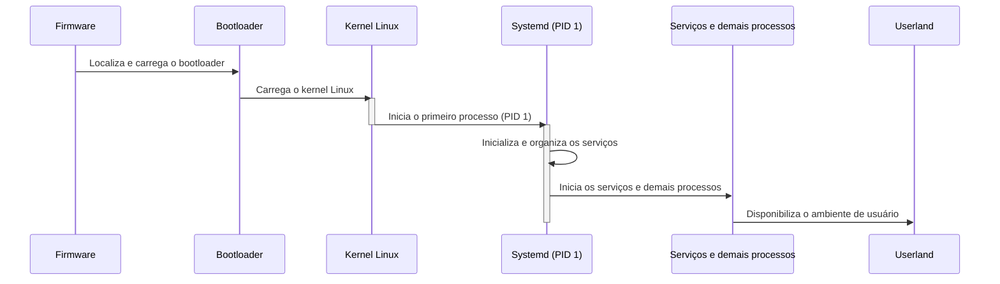
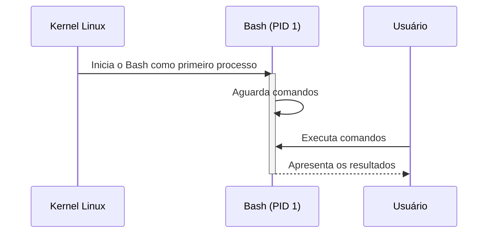
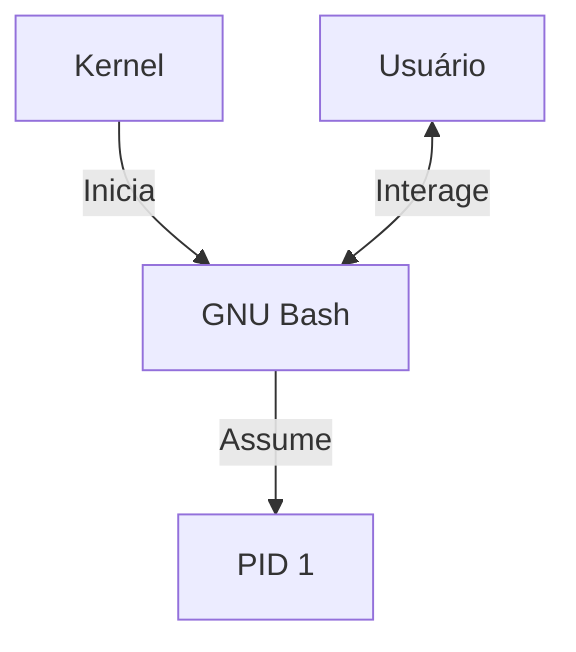
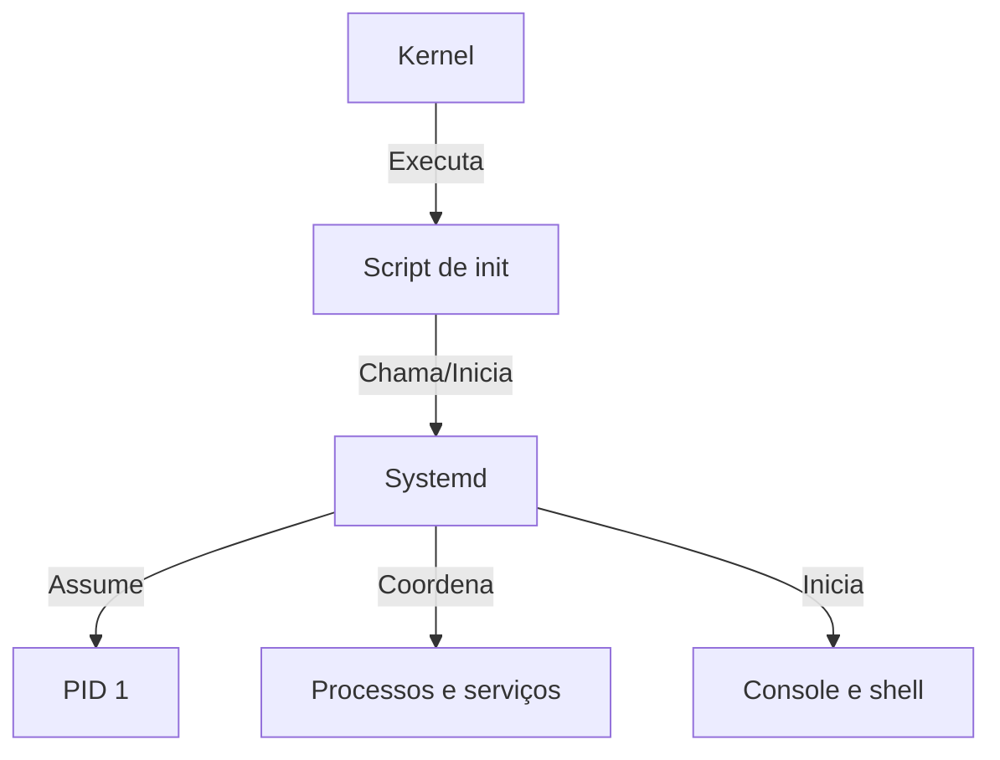

# **Init System**

Após termos construído nossa `userland`, chegou o momento de substituir o **Bash**, que até então estava atuando como **PID 1**, por um sistema de inicialização próprio. Para isso, utilizaremos o **Systemd**.

O Systemd será responsável por assumir o processo de inicialização do LecOS e gerenciar os serviços e processos que serão executados durante o funcionamento do sistema.

Diferentemente do estágio anterior, no qual o Bash era iniciado diretamente pelo kernel e permanecia como o processo principal, agora teremos uma estrutura de inicialização mais próxima daquela encontrada em distribuições GNU/Linux convencionais.

## **Sobre o Init-System**

O `init-system` é o componente responsável por assumir o controle do sistema após o kernel terminar sua própria inicialização.

O kernel é carregado pelo bootloader e começa sua execução. Depois de inicializar os recursos básicos necessários para o funcionamento do sistema, ele procura pelo processo de inicialização, que será executado como **PID 1**.



Enquanto, no estágio anterior do LecOS, o Bash ocupava temporariamente esse papel:



> Diagramas 1 e 2: Sequência do processo de inicialização, comparanto as alternativas do Systemd (init-system real) com o GNU Bash.

Isso foi suficiente para demonstrarmos a relação entre o kernel e a `userland`, mas não é uma estrutura adequada para administrar um sistema completo.

Um `init-system` precisa, entre outras funções, iniciar processos, supervisionar serviços, organizar a inicialização do sistema e participar do desligamento e reinicialização da máquina.

É justamente nessa função que entra o Systemd.

## **Sobre o Systemd**

O **Systemd** é um sistema de inicialização e gerenciamento de serviços para sistemas GNU/Linux. Ele assume o papel de **PID 1** e fornece mecanismos para inicializar o sistema, iniciar e supervisionar serviços, gerenciar sessões e controlar operações como desligamento e reinicialização.

<div align="center">


</div>

> Imagem 1: Logo do Systemd. 

Além do processo principal, o Systemd fornece diversas ferramentas e componentes. Entre eles estão o `systemctl`, utilizado para controlar serviços e unidades, o `journalctl`, utilizado para consultar os registros do sistema, e componentes como `systemd-logind`, responsável pelo gerenciamento de sessões de usuários.

Para o LecOS, o Systemd será utilizado principalmente para substituir o Bash como `PID 1` e fornecer a estrutura necessária para que o sistema possa evoluir para uma distribuição GNU/Linux mais completa, ainda se mantendo em um escopo minimalista.

Pensando nisso, não precisamos habilitar todos os recursos oferecidos pelo Systemd. O objetivo é construir uma base funcional e compreensível sem a necessidade de se compilar e instalar a versão completa do mesmo, pois tornaria nosso sistema um tanto quanto mais pesado pelas inúmeras dependências que o Systemd carrega.

Neste framework, estamos utilizando a versão **257.13** do Systemd, mantendo uma versão fixa assim como os demais componentes a fim de se evitar problemas de compatibilidade.

## **Instalando e configurando**

A compilação do Systemd depende de ferramentas de desenvolvimento e de bibliotecas que precisam estar disponíveis no ambiente de construção. Para evitar que o aluno tenha de executar manualmente uma longa sequência de comandos, todo esse processo será automatizado pelo script de build preparado para o LecOS.

O Systemd utiliza o **Meson** como sistema de configuração e o **Ninja** como ferramenta de compilação, se diferenciando dos demais componentes que vimos no decorrer do trabalho que utilizam o `make` para essa finalidade. Também utiliza ferramentas como `gperf`, Python e Jinja2 durante o processo de construção. A documentação do próprio projeto lista essas ferramentas entre os requisitos de compilação. 

> Não precisaremos nos preocupar em instalar, uma vez que nosso ambiente de desenvolvimento já fornece parte dessas ferramentas, com exceção das que necessitam de serem baixadas através do `wget`.

O script compila e instala as dependências selecionadas — `libcap 2.75`, `kmod 34.2` e `zstd 1.5.7` — e depois configura, compila e instala o Systemd 257.13. Para isso, como em componentes anteriores, estaremos baixando os **tarballs** dos mesmos através do `wget`, garantindo o código fonte em nosso ambiente de construção e permitindo o script correr como deveria. 

Além disso, precisaremos também instalar os `headers do kernel`, sendo uma dependência essencial para o systemd. Com isso em mente, ao fazer o download do tarball do Kernel Linux `6.12.108` e extrair o conteúdo com o comando **tar**, basta rodar os seguintes comandos, na pasta do kernel:

```bash
cd /LOS/Componentes/linux-6.12.108

make ARCH=x86_64 headers_install \
    INSTALL_HDR_PATH="$LOS/usr"
```

> Os headers do kernel Linux são arquivos que contêm definições e declarações das interfaces disponibilizadas pelo kernel, permitindo que programas e bibliotecas do sistema utilizem essas interfaces durante a compilação. No LecOS, eles são necessários para atender às dependências de componentes como o Systemd.

Componentes baixados e headers instalados, podemos enfim prosseguir para a compilação e instalação dos mesmos, além do próprio **Systemd**, certifique-se de que os códigos-fonte dos componentes esperados pelo script estejam disponíveis em `/LOS/Componentes` em suas respectivas versões. Após garantir que todos os componentes estão presentes, execute o script de build do Systemd:

```bash
# Acesse o diretório de scripts 
cd /LOS/Componentes/scripts

# Forneça a permissão de execução e, após, execute o script
./systemd-build.sh
```

### **O que o script faz?**

1. **Compila e instala a libcap 2.75.** A biblioteca fornece interfaces para trabalhar com as capacidades do kernel Linux.
2. **Compila e instala o kmod 34.2.** Esse componente disponibiliza ferramentas e a biblioteca `libkmod`, utilizada pelo Systemd quando o suporte a módulos do kernel está habilitado.
3. **Compila e instala o zstd 1.5.7.** Essa biblioteca oferece o algoritmo de compressão Zstandard, habilitado nesta construção do Systemd.
4. **Prepara o ambiente de compilação.** As variáveis `SYSROOT`, `CPPFLAGS`, `CFLAGS`, `CXXFLAGS`, `LDFLAGS` e `PKG_CONFIG_PATH` orientam as ferramentas para encontrar os cabeçalhos e as bibliotecas instalados na rootfs do LecOS, em vez de depender inadvertidamente dos arquivos do sistema hospedeiro.
5. **Verifica as dependências.** Antes de compilar o Systemd, o script confirma a presença dos arquivos de desenvolvimento de `libcap`, `libkmod`, `libblkid`, `libmount` e `Linux-PAM`. Também verifica se o `pkg-config` reconhece a `libkmod`.
6. **Configura o Systemd com Meson.** As opções selecionadas habilitam funcionalidades necessárias ou úteis ao projeto e desabilitam outras que estão fora do escopo atual.
7. **Compila e instala o Systemd.** O Meson configura o projeto, compila os componentes e instala os arquivos dentro de `$LOS`, sem direcionar a instalação à raiz do sistema hospedeiro.

Se uma verificação falhar, o script é interrompido para evitar que a compilação continue sobre uma base incompleta.

### **Por que usamos um SYSROOT?**

Durante a compilação de uma distribuição, o sistema hospedeiro e o sistema que está sendo construído são ambientes diferentes. O hospedeiro fornece o compilador e as ferramentas de build; a rootfs do LecOS contém os cabeçalhos e as bibliotecas destinados ao sistema final.

O `SYSROOT` e as variáveis de compilação ajudam a separar esses ambientes. Já `DESTDIR="$LOS"` direciona a instalação dos arquivos para a árvore do LecOS.

Essa distinção é importante: compilar um programa usando bibliotecas do hospedeiro por engano pode produzir um executável que não funcione corretamente dentro da imagem final.

### **Quais funcionalidades foram selecionadas?**

A configuração do script não habilita todos os recursos disponíveis no Systemd. Entre as decisões mais importantes estão:

- `sysusers` e `tmpfiles` são habilitados para disponibilizar ferramentas de criação de contas de sistema e gerenciamento de arquivos temporários.
- O suporte a PAM é habilitado, aproveitando o Linux-PAM construído anteriormente.
- O suporte a `kmod` e `blkid` é habilitado para integrar o Systemd às bibliotecas correspondentes.
- O suporte a Zstandard é habilitado, enquanto zlib, XZ e LZ4 são desabilitados nesta construção.
- Recursos como `systemd-resolved`, `systemd-networkd`, `systemd-homed`, `systemd-machined`, `systemd-portabled`, `systemd-timesyncd`, `systemd-coredump` e outros componentes opcionais são desabilitados ou mantidos fora do escopo atual.
- A geração de páginas de manual e documentação HTML é desabilitada para evitar trabalho e dependências desnecessárias nesta etapa.

### **Tornando o Systemd o PID 1**

Ao final, o script apresenta verificações da instalação, incluindo o executável principal do Systemd, o `systemd-logind`, as ferramentas `systemd-sysusers` e `systemd-tmpfiles`, além de uma amostra das unidades instaladas.

Essas verificações confirmam que os arquivos esperados foram instalados na rootfs. A presença de um executável, contudo, não garante por si só que todas as suas dependências de execução estejam disponíveis.

O executável principal será instalado em:

```text
/usr/lib/systemd/systemd
```

Para que o kernel possa encontrá-lo pelo caminho convencional de inicialização, criamos o link `init` na rootfs:

```bash
ln -sf /usr/lib/systemd/systemd "$LOS/sbin/init"
```

Tendo tudo pronto, podemos enfim configurar o `Systemd` para atuar como **PID 1** do nosso sistema, e para isso, foi preparado o script `systemd-setup.sh`, o qual cuidará de todo o processo de configuração dele em nosso ambiente de desenvolvimento. Para isso, dê as `permissões` necessárias para executar e, no diretório de scripts, insira o comando:

```bash
# Forneça as permissões de execução e, em seguida, execute
./systemd-setup.sh
```

Esse script, basicamente:

* Cria os usuários e grupos de sistema necessários, utilizando o systemd-sysusers
* Configura o acesso ao terminal virtual tty1, permitindo o login pelo console
* Baixa, compila e instala o kbd, ferramenta responsável pelo gerenciamento do teclado no Linux
* Configura o layout de teclado brasileiro ABNT2, incluindo um mapa de teclado descompactado para garantir seu carregamento correto durante a inicialização
* Realiza verificações básicas para confirmar que os arquivos e as configurações necessárias foram criados

Também podemos criar os links tradicionais para os comandos de controle do sistema, caso ainda não existam:

```bash
ln -sf ../bin/systemctl "$LOS/sbin/reboot"
ln -sf ../bin/systemctl "$LOS/sbin/poweroff"
ln -sf ../bin/systemctl "$LOS/sbin/halt"
ln -sf ../bin/systemctl "$LOS/sbin/shutdown"
ln -sf ../bin/systemctl "$LOS/sbin/telinit"
```

Esses comandos são configurações posteriores à execução do script de build. Eles não recompilam o Systemd; apenas definem os caminhos tradicionais para inicialização e controle do sistema.

O resultado esperado para o link principal é semelhante a:

```text
/sbin/init -> /usr/lib/systemd/systemd
```

Quando o kernel iniciar o LecOS, esse caminho permitirá que o Systemd seja executado como **PID 1**.

## **Após a instalação**

O Systemd utiliza algumas informações básicas para identificar a instalação. Podemos definir um hostname persistente. Dentro do nosso ambiente de desenvolvimento, inserimos dentro de hostname:

```bash
echo "lecos" > "$LOS/etc/hostname"
```

> **ATENÇÃO**: Utilize o nome do seu sistema.

Tendo o hostname instanciado, podemos seguir para a criação de um arquivo simples de identificação da distribuição, muito comum em diversos sistemas GNU/Linux. Para isso, estaremos inserindo o seguinte comando:

```bash
cat > "$LOS/etc/os-release" <<'EOF'
NAME="LecOS"
VERSION="1.0"
ID=lecos
PRETTY_NAME="Lecomp Operating System"
EOF
```

O `/etc/hostname` define o nome persistente da máquina, enquanto `/etc/os-release` permite que ferramentas identifiquem a distribuição.

Também precisamos criar o identificador único da instalação através da criação de `/etc/machine-id`, fazendo parte da preparação de uma instalação Systemd. Ela deve ser feita no ambiente alvo, quando a ferramenta correspondente estiver disponível e puder ser executada corretamente. Para isso, estaremos utilizando o `chroot`:

```bash
chroot "$LOS" /usr/bin/systemd-machine-id-setup
```

Esse comando cria `/etc/machine-id`, que é utilizado pelo Systemd para identificar de forma única a instalação do sistema. O LFS também realiza essa etapa após a instalação do Systemd.

> **Change root** (`chroot`): comando que altera temporariamente o diretório raiz (`/`) de um processo, fazendo com que ele enxergue um diretório específico como a raiz do sistema. Isso permite executar ferramentas dentro do ambiente alvo do LecOS, utilizando os arquivos e as configurações desse sistema, em vez dos arquivos do sistema hospedeiro.

Feito tudo isso, podemos enfim adicionar os novos componentes para o nosso sistema. Para isso, como de costume, estaremos montando `lecos.img` no diretório `/mnt`, removendo os diretórios presentes dentro e inserindo a nova versão contendo o Systemd. Para isso, executaremos os comandos:

```bash
# Montamos novamente a imagem em /mnt
mknod /dev/loop0 b 7 0
losetup -fP --show lecos.img
kpartx -av /dev/loop0
mount /dev/mapper/loop0p1 /mnt

# Remove tudo, exceto boot e lost+found
find /mnt -mindepth 1 -maxdepth 1 \
    ! -name 'boot' \
    ! -name 'lost+found' \
    -exec rm -rf -- {} +

# Copia a rootfs atualizada
cp -a root/. /mnt/

# Sincronize as alterações
sync

# Desmonta 'lecos.img' de '/mnt' e remoção do loop device
umount /mnt
kpartx -d /dev/loop0
losetup -d /dev/loop0
```

## **Validando a inicialização**

Depois de iniciar novamente o nosso sistema no QEMU, nos depararemos com a nova tela de inicialização. Por ser a primeira vez que iniciamos o sistema com o Systemd instalado, ele solicitará a criação de uma senha para o usuário root (o administrador) para prosseguir com o setup do sistema:

<div align="center">


</div>

> Imagem :

Com o setup feito, seguiremos da nossa tela de login oficial, onde devemos fazer o login como o usuário `root` junto da senha que criamos anteriormente, entrando oficialmente em nosso sistema.

<div align="center">


</div>

> Imagem :

Estando dentro do sistema, podemos consultar o estado geral agora que o Systemd está funcionando corretamente. Para isso, utilizaremos os comandos a seguir:

```bash
systemctl is-system-running
systemctl --failed
```

O resultado pode ser `degraded` se algum serviço opcional falhar. Nesta configuração, o `systemd-logind` pode falhar porque o D-Bus está desabilitado. Por isso, devemos verificar os serviços individualmente, sem concluir automaticamente que a inicialização inteira falhou.

<div align="center">


</div>

> Imagem :

Para consultar o serviço do console:

```bash
systemctl status systemd-vconsole-setup.service --no-pager
journalctl -b -u systemd-vconsole-setup.service --no-pager
```

Se o Systemd estiver executando como PID 1, o console estiver acessível e o teclado estiver funcionando, o objetivo central desta etapa foi alcançado.

<div align="center">


</div>

> Imagem :

Por fim, para finalizar as configurações, iremos criar e setar novamente a variável `PS1` para exibir o nome do usuário e do sistema, como fizemos na etapa anterior (dessa vez, de forma permanente). Com isso, inserimos o comando a seguir, já dentro do sistema:

```bash
# Criamos /etc/profile 
cat << 'EOF' > /etc/profile
export PATH=/usr/local/bin:/usr/bin:/bin:/usr/local/sbin:/usr/sbin:/sbin
export PS1='\u@\h:\w\$ '
EOF

# Atualizamos o terminal
source /etc/profile 
```

<div align="center">


</div>

> Imagem :

Com isso, podemos dizer que nosso sistema, enfim, está com todos os seus componentes instalados e funcionando corretamente! Com eles, poderemos prosseguir para os últimos passos do nosso framework, onde iremos ver mais alguns conceitos envolvendo os sistemas operacionais através dessas ferramentas, como os processos, que veremos na próxima etapa, que se conectam diretamente ao Systemd.

### **O que mudou no processo de inicialização?**

Antes da instalação do Systemd:



Depois:



Essa é uma mudança importante na arquitetura do LecOS. O Bash continua fazendo parte da `userland`, mas deixa de ser responsável pela inicialização do sistema. Ele passa a ser apenas um **shell**, executado quando uma sessão ou outro processo precisar dele.

## **Próximos passos**

Com o Systemd assumindo o PID 1 e o console ABNT2 configurado, o LecOS passa a ter uma base de inicialização mais próxima daquela encontrada em distribuições GNU/Linux convencionais.

Na próxima etapa, estaremos nos aprofundando um pouco mais nos processos, sendo uma parte fundamental no aprendizado de sistemas operacionais. Estamos quase finalizando o módulo 3, um excelente trabalho até aqui, e nos vemos na próxima etapa!