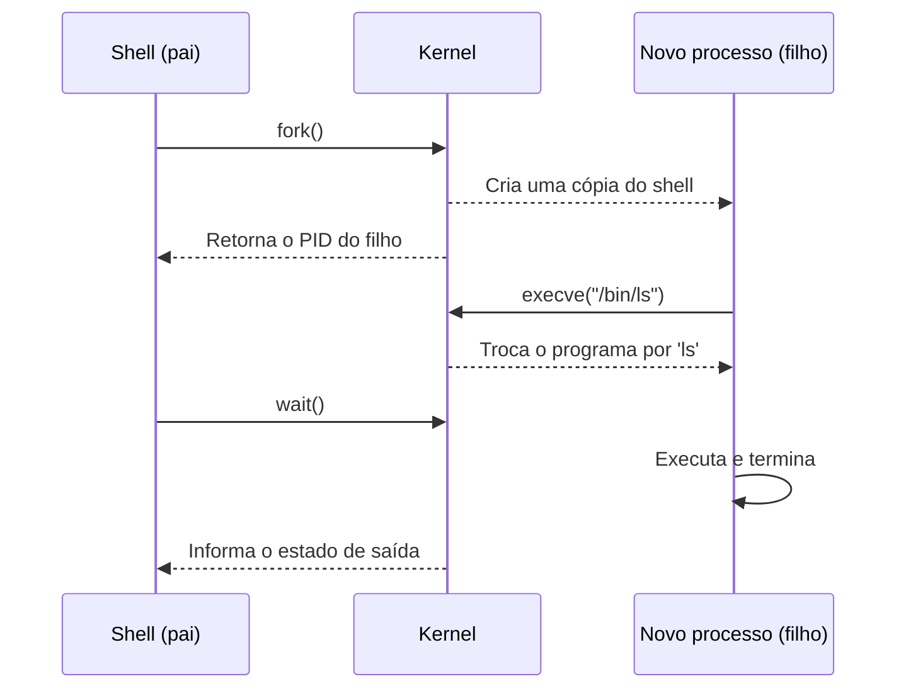
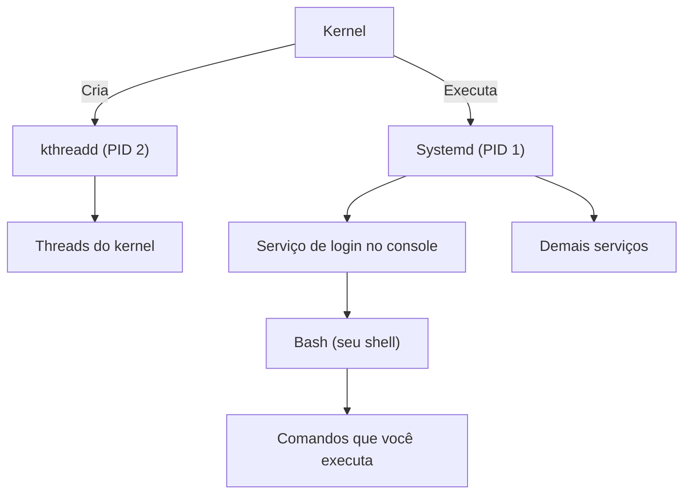
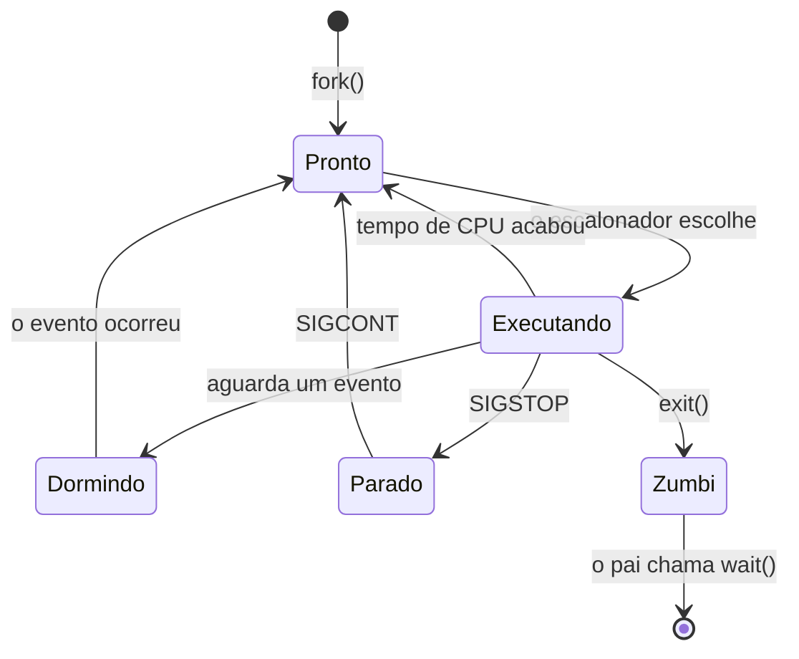

# **Processos**

Após configurarmos nosso sistema de inicialização com o **Systemd**, já somos capazes de iniciar o LecOS de maneira mais próxima ao funcionamento de uma distribuição **GNU/Linux** convencional. Entretanto, para compreendermos melhor o que acontece durante a execução do sistema, precisamos conhecer um dos conceitos fundamentais dos sistemas operacionais: os **processos**.

Nesta etapa, conheceremos como os processos funcionam, como são criados e identificados pelo `kernel Linux` e como podemos observar sua execução utilizando os componentes que já instalamos em nosso sistema. Ao final, você terá visto na prática um processo ser criado, mudar de estado, virar zumbi, ser adotado pelo Systemd e ser encerrado.

## **O que são processos?**

Um **processo** pode ser definido como uma instância de um programa em execução. Enquanto um programa é um `conjunto de instruções` armazenado em um arquivo, o processo corresponde à sua `execução`, possuindo um contexto próprio e recursos associados, como memória e estado de execução.

Uma boa analogia é a de uma receita de bolo: o programa é a receita escrita no papel, e o processo é o ato de cozinhar. A mesma receita pode ser executada várias vezes ao mesmo tempo (vários processos do mesmo programa), cada um com seus próprios ingredientes e em uma etapa diferente.

<div align="center">

| **Programa** | **Processo** |
| :--: | :--: |
| Arquivo em disco (memória secundária) | Execução em andamento (carregado na memória primária) |
| Existe mesmo com o sistema desligado | Existe apenas enquanto está em execução |
| Estático: não muda por si só | Dinâmico: possui estado, memória e recursos |
| Ex.: `/usr/bin/sleep` | Ex.: um `sleep 300` em execução com PID 4821 |

</div>

>Tabela 1: Diferenças entre programa e processo.

Para cada processo, o kernel mantém um conjunto de informações, entre elas:

* **PID** (`Process ID`): identificador numérico único do processo;
* **PPID** (`Parent PID`): identificador do processo pai;
* **Estado**: o que o processo está fazendo no momento (veremos adiante);
* **Memória**: o espaço de endereços que pertence somente a ele;
* **Arquivos abertos**: os recursos que ele está utilizando, incluindo o terminal;
* **Usuário dono**: define as permissões com as quais ele executa.

> Um processo pode ter mais de uma **thread**, que são linhas de execução que compartilham a mesma memória. Neste módulo, trabalharemos apenas com processos de uma única thread para manter o foco.

## **De onde vêm os processos?**

No Linux, todo processo (com exceção do primeiro) é criado por outro processo, formando uma relação de **pai e filho** e, consequentemente, uma árvore. Essa criação é feita por chamadas de sistema que o kernel disponibiliza:

* **`fork()`**: cria um novo processo, que nasce como uma cópia do processo que a invocou;
* **`execve()`**: substitui o programa em execução pelo programa indicado;
* **`wait()`**: permite ao processo pai aguardar o término de um filho e recolher seu estado de saída.

É a combinação delas que acontece, por exemplo, sempre que digitamos um comando no shell:



> Diagrama 1: O que acontece quando executamos um comando como `ls` no shell.

Sendo assim, o shell que utilizamos no LecOS é, ele próprio, um processo, filho de outro processo, que por sua vez é filho de outro, até chegarmos ao **PID 1**, o Systemd. Existe ainda o **PID 2**, o `kthreadd`, responsável por criar as **threads do kernel**, que são tarefas internas do próprio kernel (e não programas de espaço de usuário).



> Diagrama 2: Árvore de processos simplificada do LecOS. Os nomes exatos variam conforme os serviços ativos.

É importante compreender que o Systemd não é responsável por executar sozinho todas as operações relacionadas aos processos. O kernel é responsável por criar e gerenciar sua execução, enquanto os programas do espaço de usuário solicitam a criação de novos processos e acompanham seu funcionamento. O Systemd, por ocupar o PID 1, soma a isso o papel de iniciar os serviços, acompanhá-los e adotar os processos que ficarem sem pai.

## **O ciclo de vida de um processo**

O `kernel Linux` controla aspectos como o estado de execução, a utilização da CPU e os recursos de cada processo. Entre os estados possíveis, podemos destacar:

<div align="center">

| **Código** | **Estado** | **Significado** |
| :--: | :--: | :--: |
| **R** | Running | Em execução ou pronto para utilizar a CPU |
| **S** | Sleeping | Aguardando um evento (fim de uma operação, tempo, entrada do teclado) |
| **D** | Disk sleep | Aguardando uma operação de entrada/saída que não pode ser interrompida |
| **T** | Stopped | Execução suspensa (por um sinal ou pelo controle de jobs do shell) |
| **Z** | Zombie | Já terminou, mas o pai ainda não recolheu seu estado de saída |
| **I** | Idle | Thread do kernel ociosa |

</div>

>Tabela 2: Principais estados de um processo, como exibidos pelo kernel.

Esses estados permitem compreender que nem todos os processos estão executando instruções continuamente. Na verdade, na imensa maioria do tempo, quase todos estão no estado `S`, aguardando algo acontecer.



> Diagrama 3: Ciclo de vida simplificado. No Linux, "Pronto" e "Executando" aparecem juntos como `R`.

O estado **Zombie** merece atenção especial. Um zumbi não consome CPU nem memória: ele é apenas uma entrada na tabela de processos que guarda o estado de saída até que o pai o leia com `wait()`. Se o pai nunca o fizer, ele permanece ali. Quando o **pai termina antes do filho**, o filho se torna um processo **órfão** e é adotado pelo PID 1, que passa a ser seu pai e recolhe seu estado quando ele terminar. Essa é uma das razões pelas quais o PID 1 precisa ser um programa robusto, como vimos na etapa do Init System.

### **Escalonamento**

Como existem muito mais processos do que núcleos de CPU, o kernel utiliza um mecanismo denominado **escalonamento**, responsável por decidir qual processo poderá utilizar a CPU em determinado momento. Cada processo roda por uma fatia de tempo muito curta e, ao fim dela (ou ao precisar aguardar algo), o kernel troca para outro. Essa troca é chamada de **troca de contexto**. Como ela acontece milhares de vezes por segundo, temos a impressão de que tudo executa ao mesmo tempo.

### **Sinais**

Para se comunicar com um processo em execução, o kernel e outros processos utilizam **sinais**, que são notificações curtas e numeradas. Os principais são:

<div align="center">

| **Sinal** | **Nº** | **Efeito** |
| :--: | :--: | :--: |
| `SIGTERM` | 15 | Pede educadamente que o processo termine (padrão do `kill`). Pode ser tratado ou ignorado |
| `SIGKILL` | 9 | Encerra o processo imediatamente. **Não pode** ser tratado nem ignorado |
| `SIGINT` | 2 | Interrupção pelo teclado (`Ctrl` + `C`) |
| `SIGSTOP` | 19 | Suspende o processo. Não pode ser ignorado |
| `SIGCONT` | 18 | Retoma um processo suspenso |
| `SIGCHLD` | 17 | Avisa o pai de que um filho terminou |

</div>

>Tabela 3: Sinais mais utilizados.

## **O diretório /proc**

Todas as informações que o kernel mantém sobre os processos ficam disponíveis para nós através do **`/proc`**, o sistema de arquivos virtual que o próprio kernel gera. Nada ali está gravado no disco: cada arquivo é construído no instante em que o lemos, refletindo o que está acontecendo naquele momento. No LecOS, ele é montado automaticamente pelo Systemd durante o boot, substituindo o comando `mount` que escrevíamos no nosso script `init`.

Cada processo possui um diretório com o seu PID, e os arquivos mais úteis para nós são:

<div align="center">

| **Caminho** | **Conteúdo** |
| :--: | :--: |
| `/proc/PID/status` | Nome, estado, PID, PPID, memória utilizada e outras informações em texto legível |
| `/proc/PID/cmdline` | O comando completo com que o processo foi iniciado |
| `/proc/PID/exe` | Link para o executável do processo |
| `/proc/PID/cwd` | Link para o diretório em que o processo está |
| `/proc/PID/fd/` | Os arquivos (e terminais) que o processo mantém abertos |
| `/proc/self` | Atalho para o `/proc` do próprio processo que o consulta |

</div>

>Tabela 4: Principais entradas de `/proc/PID`.

Ferramentas como o `ps` e o `top`, do pacote `procps-ng`, não possuem nenhuma mágica: elas apenas leem esses arquivos e formatam o resultado. Para provar isso, nós mesmos vamos fazer o papel do `ps` em nosso sistema.

## **Colocando em prática**

Em vez de instalarmos o `procps-ng`, utilizaremos o `lps`, um pequeno script em Bash que lê o `/proc` e exibe os processos. Ele está pronto no diretório `Componentes_Principais` do repositório e utiliza somente o que já temos no LecOS (Bash e Coreutils). Para entendermos como ele funciona, o coração do script é este laço, que lê o arquivo `status` de cada processo — não copie o código a seguir, será apenas para visualizarmos:

```bash
for dir in /proc/[0-9]*; do        # cada diretório numérico é um processo
    pid=${dir#/proc/}              # extrai o PID do caminho
    while read -r chave valor; do  # lê o 'status' linha por linha
        case $chave in
            Name:)  nome=$valor ;;
            State:) estado=${valor%% *} ;;
            PPid:)  ppid=$valor ;;
        esac
    done < "$dir/status"
    echo "$pid $ppid $estado $nome"
done
```

O `lps` aceita as seguintes opções:

* **`lps`**: lista os processos de espaço de usuário, com PID, PPID, estado e nome;
* **`lps -t`**: mostra os processos em formato de árvore, deixando clara a relação entre pai e filho;
* **`lps -k`**: inclui também as threads do kernel;
* **`lps -i PID`**: exibe os detalhes de um processo (nome, estado, memória, trocas de contexto...).

### **Instalando o lps**

O processo é semelhante ao que fizemos com o kernel. Primeiro, em nosso sistema principal, copiamos o script para o contêiner:

```bash
# Entra no diretório 'Componentes_Principais'
cd Componentes_Principais

# Copia o script 'lps' para dentro do contêiner
docker cp lps LecOS-dev:/LOS
```

Dentro do contêiner, no diretório `/LOS`, guardamos o script na nossa `root` (para que ele faça parte do sistema em futuras reconstruções) e o inserimos na imagem:

```bash
# Instala o 'lps' na árvore do sistema
mkdir -p root/usr/bin
cp lps root/usr/bin/lps
chmod +x root/usr/bin/lps

# Montamos novamente a imagem em /mnt
mknod /dev/loop0 b 7 0
losetup -fP --show lecos.img
kpartx -av /dev/loop0
mount /dev/mapper/loop0p1 /mnt

# Copia somente o script para dentro da imagem
mkdir -p /mnt/usr/bin
cp root/usr/bin/lps /mnt/usr/bin/lps

# Sincroniza, desmonta e remove o loop device
sync
umount /mnt
kpartx -d /dev/loop0
losetup -d /dev/loop0
```

> **ATENÇÃO**: desta vez, **não** copie todo o conteúdo de `root` para a imagem como fizemos na etapa do Init System. Copiamos apenas o `lps`.

Por fim, copiamos a imagem para o sistema principal e iniciamos o LecOS no QEMU:

```bash
# Copia 'lecos.img' para o diretório atual
docker cp [ID_CONTAINER]:/LOS/lecos.img .

# Realiza o boot no QEMU
qemu-system-x86_64 lecos.img
```

Após o login, já podemos utilizar o `lps`. Vamos aos experimentos!

> **NOTA**: A função de colar não funciona no QEMU. Digite os comandos manualmente, sem os comentários (o que vem após o `#`).

### **Experimento 1: quem é o PID 1 e quem sou eu?**

Vamos começar descobrindo onde o nosso próprio shell se encaixa na árvore de processos:

```bash
# PID do shell atual e PID do seu pai
echo "Meu PID: $$"
echo "PID do meu pai: $PPID"

# Árvore de processos do sistema
lps -t

# Quem é o PID 1?
cat /proc/1/comm
```

A saída do `lps -t` será semelhante a esta (os PIDs e os nomes dos serviços variam):

```text
systemd (1) [S]
    ...
    login (214) [S]
        bash (231) [S]
            lps (260) [R]
```

Repare que o `lps` aparece como filho do seu `bash`, que é filho do programa de login, que por sua vez é filho do `systemd` (PID 1). É exatamente a cadeia do Diagrama 2. Também vale executar `lps -k` para ver as threads do kernel, que aparecem como filhas do PID 2.

<div align="center">


</div>

> Imagem 1: Verificando o PID dos processos.

### **Experimento 2: fork e exec na prática**

Lembra do `fork()`? Cada vez que executamos um comando, o shell cria um filho. Podemos provar isso pedindo para o filho nos dizer quem é o seu pai:

```bash
echo "Shell: $$"
bash -c 'echo "Filho: $$ | Pai: $PPID"'
```

<div align="center">


</div>

> Imagem 2: Processo filho gerado pelo Bash.

O PID do pai exibido pelo filho é exatamente o PID do nosso shell. Execute o segundo comando algumas vezes e observe que o PID do filho muda a cada execução: cada comando é um processo novo.

### **Experimento 3: criando e inspecionando um processo**

Agora vamos criar um processo que permaneça ativo para podermos observá-lo. O comando `sleep` aguarda o tempo indicado, e o caractere `&` o executa em segundo plano:

```bash
# Inicia um processo em segundo plano
sleep 300 &

# Guarda o PID do último processo iniciado em segundo plano
P=$!
echo "PID do processo: $P"

# Detalhes do processo
lps -i $P
```

<div align="center">


</div>

> Imagem 3: Criando e verificando o processo.

No resultado, observe os campos:

* **Name**: nome do processo (`sleep`);
* **State**: o estado atual. Como o `sleep` apenas aguarda o tempo passar, o esperado é `S (sleeping)`;
* **Pid** e **PPid**: o PID do `sleep` e o PID do nosso shell, que o criou;
* **VmRSS**: quantidade aproximada de memória RAM que o processo utiliza neste momento;
* **voluntary_ctxt_switches** e **nonvoluntary_ctxt_switches**: quantas vezes o processo deixou a CPU por conta própria (para aguardar algo) e quantas vezes o kernel o retirou à força. São as trocas de contexto que vimos no escalonamento.

Agora, vamos olhar para dentro do `/proc` do processo:

```bash
# O comando completo (os argumentos são separados por caracteres nulos)
tr '\0' ' ' < /proc/$P/cmdline; echo

# O executável e o diretório do processo
ls -l /proc/$P/exe /proc/$P/cwd

# Os arquivos que ele mantém abertos
ls -l /proc/$P/fd
```

<div align="center">


</div>

> Imagem 4: Verificando o diretório `/proc`, com as informações dos processos.

O `exe` aponta para o programa `sleep` (o que aprendemos sobre programa e processo!). Na pasta `fd`, os números `0`, `1` e `2` correspondem à entrada, à saída e ao erro padrão, e todos apontam para o terminal em que estamos. Isso será o ponto de partida da próxima etapa, sobre entrada e saída.

### **Experimento 4: mudando o estado de um processo**

Vamos usar sinais para alterar o estado do `sleep` que acabamos de criar:

```bash
# Suspende o processo
kill -STOP $P
lps -i $P

# Retoma o processo
kill -CONT $P
lps -i $P
```

<div align="center">


</div>

> Imagem 5: Parando e reiniciando o processo.

Observe o campo **State**: após o `SIGSTOP`, ele passa para `T (stopped)` e, após o `SIGCONT`, volta para `S (sleeping)`. O processo continuou existindo o tempo todo; apenas o kernel deixou de escaloná-lo.

> O `kill` e o `wait` são comandos internos do Bash (*builtins*). O nome `kill` pode enganar: ele não "mata", apenas **envia um sinal**. O efeito de matar é uma consequência do sinal `SIGTERM`, que é o padrão.

### **Experimento 5: criando um zumbi**

Para criar um zumbi precisamos de um pai que não recolha o estado de seu filho. Faremos isso com um truque: o Bash cria um filho que termina em 1 segundo e, em seguida, se transforma (`exec`) em um `sleep 60`, que nunca chama `wait()`:

```bash
# Cria o "pai descuidado" em segundo plano
bash -c 'sleep 1 & exec sleep 60' &
Z=$!

# Aguarda o filho terminar e lista os processos
sleep 3
lps
```

<div align="center">


</div>

> Imagem 6: Criando e verificando o processo zumbi.

Na listagem, procure um processo `sleep` com estado **Z** e cujo PPID seja o `$Z`. É o nosso zumbi: ele já terminou, mas o seu pai ainda não leu o seu estado de saída.

Agora vamos remover o pai do zumbi e ver o que acontece:

```bash
kill $Z
sleep 1
lps
```

<div align="center">


</div>

> Imagem 7: Processo zumbi desaparecendo, sendo adotado pelo `Systemd` (PID 1).

O zumbi desapareceu. Com a morte do pai, ele foi **adotado pelo PID 1**, e o Systemd recolheu o seu estado de saída (o `wait()` que faltava). Esse é um exemplo prático do papel do init que estudamos na etapa anterior.

### **Experimento 6: órfãos e o PID 1**

Vamos ver a adoção acontecendo de forma direta. O comando abaixo inicia um shell que cria um `sleep` em segundo plano e termina imediatamente, deixando o seu filho sem pai:

```bash
bash -c 'sleep 300 & echo "Filho: $!"'
lps
```

<div align="center">


</div>

> Imagem 8: Processo órfão sendo adotado pelo **PID 1**.

Procure pelo `sleep` na lista: o seu PPID não é mais o do shell que o criou, e sim **1**. Em `lps -t`, ele aparece diretamente abaixo do `systemd`. Foi o kernel quem fez essa troca de pai, e é por isso que o PID 1 precisa permanecer em execução durante todo o funcionamento do sistema.

### **Experimento 7: sinais e o SIGKILL**

Por padrão, o `kill` envia o `SIGTERM`, que é apenas um pedido de encerramento. Um programa pode tratá-lo ou até ignorá-lo. Vamos criar um processo "teimoso" que ignora esse pedido:

```bash
# Processo que reage ao SIGTERM apenas exibindo uma mensagem
bash -c 'trap "echo ignorei o SIGTERM" TERM; while :; do sleep 1; done' &
T=$!

# Pede educadamente que ele termine
kill $T
sleep 2
lps -i $T
```

A mensagem aparece, e o processo continua em execução. Isso mostra que o envio de um sinal não garante que o processo será encerrado imediatamente. Agora, vamos usar o sinal que não pode ser ignorado:

```bash
kill -9 $T
sleep 1
lps -i $T
```

<div align="center">


</div>

> Imagem 9: Processo ignorando o pedido de encerramento.

Dessa vez, o processo foi encerrado pelo kernel, sem chance de reação, e o `lps` informa que ele não existe mais. O `SIGKILL` deve ser o último recurso, pois o programa não tem a chance de salvar dados ou liberar recursos antes de terminar.

### **Visão do Systemd sobre os processos**

Por fim, podemos ver como o Systemd agrupa os processos do sistema. Ele organiza cada serviço em um grupo (**cgroup**), o que permite saber exatamente quais processos pertencem a cada serviço e encerrá-los juntos:

```bash
systemd-cgls --no-pager
```

<div align="center">


</div>

> Imagem 10: Árvore de grupos e seus respectivos processos.

O resultado mostra uma árvore de grupos, e dentro de cada serviço, os processos que ele iniciou, incluindo o seu próprio shell, que pertence ao serviço de login do console. É o Systemd supervisionando os processos que ele iniciou.

### **Encerrando os testes**

Para finalizar, vamos encerrar o que ficou em execução. O `sleep 300` do Experimento 3 ainda está ativo, assim como o `sleep` órfão do Experimento 6:

```bash
# Encerra o processo do Experimento 3
kill $P

# Confira o que sobrou e encerre o órfão pelo PID
lps
kill [PID_DO_SLEEP_ORFAO]
```

<div align="center">


</div>

> Imagem 11: Finalizando os processos restantes.

## **O que vimos na prática**

<div align="center">

| **Experimento** | **Conceito demonstrado** |
| :--: | :--: |
| 1 | Árvore de processos e o Systemd como PID 1 |
| 2 | `fork()`: cada comando é um processo filho do shell |
| 3 | Programa x processo, `/proc` e arquivos abertos |
| 4 | Estados do processo (`S` e `T`) e sinais |
| 5 | Zumbis (`Z`) e a função do `wait()` |
| 6 | Órfãos adotados pelo PID 1 |
| 7 | `SIGTERM` x `SIGKILL` |

</div>

>Tabela 5: Resumo dos experimentos e dos conceitos relacionados.

## **Conclusão**

Nesta etapa, conhecemos os fundamentos dos processos e sua importância para o funcionamento de um sistema operacional. Vimos como eles são criados com `fork()` e `execve()`, como passam por diferentes estados durante sua vida, como se comunicam por sinais e como o kernel Linux disponibiliza todas essas informações através do `/proc`. Mais do que isso, construímos o nosso próprio listador de processos e comprovamos que ferramentas como o `ps` apenas leem esses dados.

Com o conhecimento adquirido, conseguimos compreender melhor o que acontece após a inicialização do LecOS: o sistema passa a executar processos que realizam as tarefas necessárias ao seu funcionamento, todos descendentes do Systemd.

Na próxima etapa, aprofundaremos outro aspecto fundamental dos sistemas operacionais: a **entrada e saída de dados**, compreendendo como os programas interagem com os recursos disponíveis (como os arquivos `0`, `1` e `2` que vimos em `/proc/PID/fd`) e como essas operações participam do funcionamento do sistema.