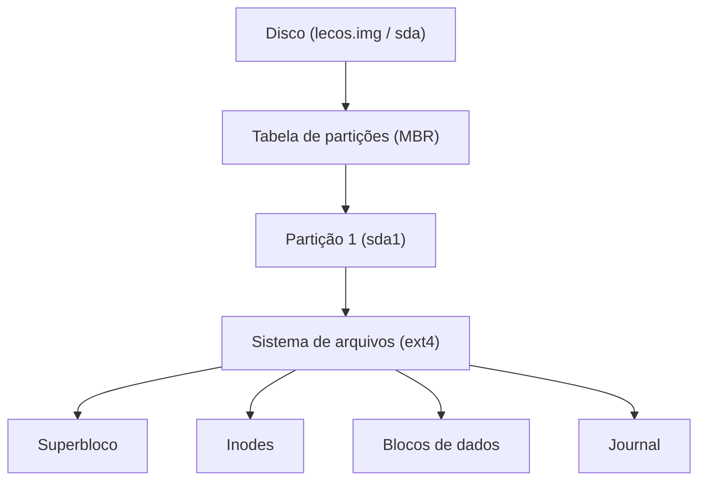
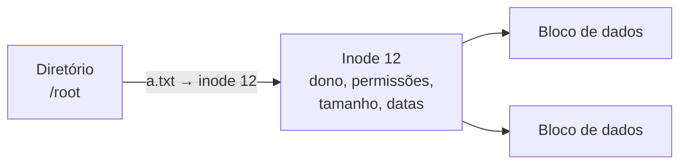
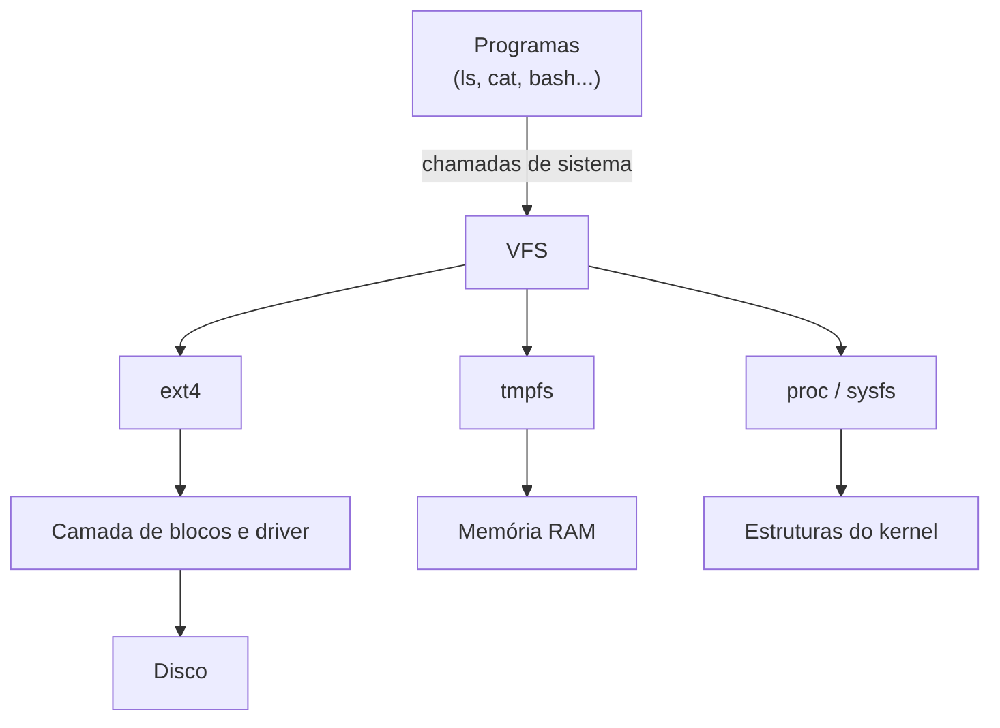

# **Sistema de Arquivos**

Na etapa anterior, vimos que o `/dev/sda1` é, para o kernel, apenas uma sequência de blocos de bytes. Porém, não é assim que utilizamos o sistema: nós criamos arquivos, organizamos diretórios, damos nomes, definimos permissões. Nenhuma dessas ideias existe no disco "cru". Quem as constrói é o **sistema de arquivos**, a última peça do nosso quebra-cabeça.

Na verdade, ele esteve presente durante todo o framework: formatamos a partição com `mkfs.ext4`, montamos a imagem em `/mnt` diversas vezes e passamos `root=/dev/sda1` ao kernel. Agora, é hora de entender o que cada um desses passos significa.

## **O que é um sistema de arquivos?**

Um **sistema de arquivos** (*file system*) é a estrutura e o conjunto de regras que o sistema operacional utiliza para organizar os dados em um dispositivo de armazenamento. Podemos pensar em um disco como uma enorme estante com milhões de posições numeradas (os blocos). Sem um catálogo, seria impossível saber em quais posições está o seu documento. O sistema de arquivos é esse catálogo, somado às regras para mantê-lo organizado.

Entre suas responsabilidades, estão:

* Dar **nome** aos arquivos e organizá-los em **diretórios**;
* Saber **quais blocos** do disco pertencem a cada arquivo;
* Controlar quais blocos estão **livres** e quais estão ocupados;
* Guardar **metadados**: dono, permissões, tamanho, datas de criação e modificação;
* Manter os dados **consistentes**, mesmo em caso de falha de energia.

É importante não confundir os conceitos. A **partição** divide o disco em áreas, e é descrita pela tabela de partições (o MBR que criamos com o `fdisk`). O **sistema de arquivos** organiza o que existe *dentro* de uma partição (o que fizemos com o `mkfs.ext4`).



>Diagrama 1: Do disco ao sistema de arquivos. Cada camada organiza a seguinte.

<div align="center">

| **Etapa do framework** | **O que fizemos** | **Conceito** |
| :--: | :--: | :--: |
| Bootloader | `fdisk lecos.img` | Criação da **partição** |
| Bootloader | `mkfs.ext4 /dev/mapper/loop0p1` | Criação do **sistema de arquivos** |
| Bootloader | `mount /dev/mapper/loop0p1 /mnt` | **Montagem** na árvore de diretórios |

</div>

>Tabela 1: Onde já utilizamos cada conceito.

## **Como o ext4 organiza os dados**

O sistema de arquivos que utilizamos no LecOS é o **ext4** (*fourth extended filesystem*), o padrão de grande parte das distribuições GNU/Linux. Em sua estrutura, existem alguns elementos fundamentais:

<div align="center">

| **Elemento** | **Função** |
| :--: | :--: |
| **Bloco** | Menor unidade de armazenamento do sistema de arquivos (normalmente 4 KiB) |
| **Superbloco** | Guarda as informações gerais: tipo, tamanho, quantidade de inodes e blocos, e um número de identificação do ext4 |
| **Inode** | Guarda os metadados de um arquivo (dono, permissões, tamanho, datas) e onde estão seus blocos de dados. **Não guarda o nome** |
| **Diretório** | Um arquivo especial que lista pares de *nome → número do inode* |
| **Journal** | Um "diário" das alterações em andamento, usado para recuperar a consistência |

</div>

>Tabela 2: Principais elementos do ext4.

O detalhe mais importante é que **o nome de um arquivo não faz parte do arquivo**. Ele é apenas uma entrada em um diretório, que aponta para um inode. É o inode quem sabe tudo o mais sobre o arquivo:



>Diagrama 2: Para abrir `/root/a.txt`, o kernel procura o nome no diretório, encontra o inode e, através dele, os blocos com o conteúdo.

Isso explica coisas que veremos na prática, como os **links físicos** (dois nomes apontando para o mesmo inode). Também explica por que o número de arquivos é limitado: a quantidade de inodes é definida na criação do sistema de arquivos, e é possível ficar sem inodes mesmo com espaço livre.

### **O journal**

Imagine que o sistema perde a energia no meio da gravação de um arquivo: o diretório pode já apontar para um inode, mas o inode ainda não ter sido atualizado. Para evitar esse tipo de inconsistência, o ext4 é um sistema de arquivos com **journaling**: antes de modificar a estrutura principal, ele anota a operação no journal. Se a energia acabar, na próxima montagem o kernel consulta o journal e termina (ou descarta) as operações pendentes.

O journal protege a **estrutura**, mas não resolve outra questão que já encontramos: os dados passam primeiro pela **memória RAM** (o *cache*) antes de ir ao disco. O comando `sync`, que repetimos nas etapas anteriores, existe para forçar essa transferência para a memória secundária antes de desligarmos ou desmontarmos algo.

## **Tipos de sistemas de arquivos**

O Linux é capaz de trabalhar com diversos sistemas de arquivos, que se dividem em dois grandes grupos: os que armazenam dados em um **dispositivo** (disco) e os **virtuais**, que existem na memória ou são gerados pelo kernel.

<div align="center">

| **Tipo** | **Grupo** | **Característica** |
| :--: | :--: | :--: |
| `ext4` | Disco | Padrão em diversas distribuições, com journaling. Utilizado no LecOS |
| `XFS` | Disco | Bom desempenho com grandes volumes e arquivos |
| `Btrfs` | Disco | Recursos avançados, como *snapshots* e verificação de integridade |
| `FAT32` (`vfat`) | Disco | Simples e compatível com praticamente qualquer sistema. É o formato exigido pela **ESP** do UEFI |
| `NTFS` | Disco | Sistema de arquivos do Windows |
| `tmpfs` | Virtual | Armazena os arquivos na **memória RAM**. O conteúdo some ao desligar |
| `proc` e `sysfs` | Virtual | Expõem informações do kernel como arquivos (`/proc` e `/sys`) |
| `devtmpfs` | Virtual | Mantém os arquivos de dispositivo em `/dev` |

</div>

>Tabela 3: Alguns dos sistemas de arquivos suportados pelo Linux.

Os virtuais são velhos conhecidos nossos: o `/proc` foi a base de toda a etapa de Processos, e o `/dev`, a da Entrada e Saída. Já o `tmpfs` nos fará lembrar do experimento de volatilidade da etapa da Memória.

### **O VFS**

Se cada sistema de arquivos funciona de um jeito, como o `ls` e o `cat` conseguem trabalhar com todos eles sem saber a diferença? A resposta é o **VFS** (*Virtual File System*), uma camada do kernel que oferece uma interface única (abrir, ler, escrever, listar) e repassa o pedido ao sistema de arquivos responsável.



>Diagrama 3: O VFS permite que o mesmo `cat` leia arquivos do disco, da RAM ou do próprio kernel.

## **Uma árvore, vários dispositivos: a montagem**

Diferente de outros sistemas, que atribuem uma letra a cada unidade (como `C:` e `D:`), o Linux possui **uma única árvore de diretórios**, que começa na raiz (`/`). Para tornar o conteúdo de outro dispositivo ou sistema de arquivos acessível, nós o **montamos** em um diretório existente, chamado de **ponto de montagem**. Foi exatamente isso que fizemos várias vezes durante o framework com o `mount /dev/mapper/loop0p1 /mnt`.

Quando o LecOS inicia, a montagem acontece em etapas:

<div align="center">

| **Ponto de montagem** | **Sistema de arquivos** | **Quem monta** |
| :--: | :--: | :--: |
| `/` | `ext4` (`/dev/sda1`) | Kernel, a partir do `root=/dev/sda1` passado pelo GRUB |
| `/proc` | `proc` | Systemd |
| `/sys` | `sysfs` | Systemd |
| `/dev` | `devtmpfs` | Systemd |
| `/run` | `tmpfs` | Systemd |

</div>

>Tabela 4: Montagens realizadas durante a inicialização do LecOS.

É importante saber que **a montagem esconde o conteúdo anterior** do diretório: enquanto algo estiver montado ali, só enxergamos o conteúdo do sistema de arquivos montado. Ao desmontar, o conteúdo original reaparece. Veremos isso na prática.

### **O arquivo /etc/fstab**

Montagens feitas com o comando `mount` não sobrevivem a uma reinicialização. Para torná-las permanentes, existe o arquivo **`/etc/fstab`**, que lista os sistemas de arquivos a serem montados na inicialização. O Systemd lê esse arquivo e gera automaticamente uma **mount unit** para cada linha, exatamente como as units que estudamos na etapa do Init System. Cada linha possui seis campos:

```text
dispositivo   ponto-de-montagem   tipo   opções   dump   fsck
```

## **A hierarquia de diretórios**

Em sistemas GNU/Linux, a organização dos diretórios segue uma convenção chamada **FHS** (*Filesystem Hierarchy Standard*), que define o que deve ficar em cada lugar. Muitos desses diretórios já foram utilizados no nosso projeto:

<div align="center">

| **Diretório** | **Conteúdo** | **No LecOS** |
| :--: | :--: | :--: |
| `/` | Raiz da árvore | Partição `sda1` |
| `/boot` | Arquivos de inicialização | Kernel (`bzImage`) e GRUB |
| `/bin` e `/sbin` | Comandos essenciais | Coreutils, Bash e o `init` |
| `/lib` e `/lib64` | Bibliotecas essenciais | Glibc, Ncurses |
| `/usr` | Programas e bibliotecas | Systemd, em `/usr/lib/systemd`, e o `lps`, em `/usr/bin` |
| `/usr/local` | Programas instalados localmente | |
| `/etc` | Arquivos de configuração | `hostname`, `os-release`, `machine-id`, `profile` |
| `/var` | Dados variáveis (registros, cache) | Dados gerados pelo Systemd |
| `/tmp` | Arquivos temporários | |
| `/root` | Diretório pessoal do administrador | |
| `/home` | Diretórios pessoais dos usuários | |
| `/dev` | Arquivos de dispositivo | `devtmpfs` |
| `/proc` e `/sys` | Informações do kernel | `proc` e `sysfs` |
| `/run` | Dados de execução desde o boot | `tmpfs` |
| `/mnt` | Montagens temporárias | Usado em todo o framework |
| `/lost+found` | Arquivos recuperados após erros | Criado pelo `mkfs.ext4` |

</div>

>Tabela 5: Principais diretórios do FHS e seus usos no LecOS.

> Em algumas distribuições, `/bin`, `/sbin` e `/lib` são links para os respectivos diretórios dentro de `/usr`. No nosso caso, veremos como está a estrutura na prática, com o comando `ls -l /`.

## **Tipos de arquivo, permissões e links**

### **Tipos de arquivo**

Já encontramos a primeira letra da saída do `ls -l` algumas vezes, e agora podemos listar todas as possibilidades:

<div align="center">

| **Letra** | **Tipo** | **Exemplo** |
| :--: | :--: | :--: |
| `-` | Arquivo comum | `/etc/hostname` |
| `d` | Diretório | `/etc` |
| `l` | Link simbólico | `/sbin/init` |
| `c` | Dispositivo de caractere | `/dev/tty1` |
| `b` | Dispositivo de bloco | `/dev/sda` |
| `p` | Pipe nomeado | O `canal` que criamos |

</div>

>Tabela 6: Tipos de arquivo identificados pelo `ls -l`.

### **Dono e permissões**

Cada arquivo possui um **dono** (usuário), um **grupo** e três conjuntos de permissões: para o dono, para o grupo e para todos os outros. Em uma linha como `-rwxr-xr-- 1 root root 5 ...`, os nove caracteres após o tipo são lidos em trios (`rwx` / `r-x` / `r--`).

<div align="center">

| **Permissão** | **Letra** | **Valor** | **Em um arquivo** | **Em um diretório** |
| :--: | :--: | :--: | :--: | :--: |
| Leitura | `r` | 4 | Ler o conteúdo | Listar os arquivos |
| Escrita | `w` | 2 | Modificar o conteúdo | Criar e remover arquivos |
| Execução | `x` | 1 | Executar como programa | Entrar no diretório |

</div>

>Tabela 7: Permissões e seus valores numéricos.

Somando os valores de cada trio, obtemos a notação **octal**: `rwxr-xr-x` equivale a `755` (7 = 4+2+1, 5 = 4+1, 5 = 4+1), e `rw-------` equivale a `600`. Isso nos permite, finalmente, explicar o comando que utilizamos durante todo o framework: o `chmod +x` apenas **adiciona a permissão de execução** ao arquivo, e sem ela o kernel se recusa a executar um script ou programa.

### **Links**

Existem duas maneiras de dar um segundo nome a um arquivo:

<div align="center">

| **Característica** | **Link físico** (*hard link*) | **Link simbólico** (*symlink*) |
| :--: | :--: | :--: |
| O que é | Outro nome apontando para o **mesmo inode** | Um arquivo especial que guarda o **caminho** do alvo |
| Inode | Compartilhado | Próprio |
| Se o original for removido | O conteúdo continua acessível | O link **quebra** |
| Pode atravessar sistemas de arquivos | Não | Sim |
| Criação | `ln alvo nome` | `ln -s alvo nome` |

</div>

>Tabela 8: Links físicos e simbólicos.

Um exemplo que já conhecemos é o `/sbin/init`: na etapa do Init System, criamos um link simbólico para o executável do Systemd com o `ln -sf`.

## **Colocando em prática**

Vamos observar os conceitos em funcionamento. Assim como na etapa anterior, os experimentos acontecem **dentro do LecOS** e utilizam apenas o que já temos instalado (Bash, Coreutils e Util-Linux, que fornece o `mount`).

### **Experimento 1: o que está montado?**

Vamos começar vendo quais sistemas de arquivos estão montados, e de que tipo:

```bash
df -hT
```

<div align="center">


</div>

> Imagem 1: Sistemas de arquivos que estão montados.

O `df` (*disk free*), do Coreutils, mostra o espaço de cada sistema de arquivos montado. Procure pela linha do `/dev/sda1`, do tipo `ext4`, montada em `/`, com aproximadamente 10 GB. As demais (`devtmpfs`, `tmpfs`) são os sistemas virtuais que vimos na Tabela 4. A fonte desses dados é o `/proc`, como em toda a etapa de Processos:

```bash
cat /proc/mounts
```

E o Systemd também enxerga essas montagens, pois cada uma é gerenciada por uma **mount unit**:

```bash
systemctl list-units --type=mount --no-pager
```

<div align="center">


</div>

> Imagem 2: Montagens exibidas pelo Systemd.

### **Experimento 2: explorando a árvore**

```bash
# A raiz do sistema
ls -l /

# O conteúdo do /boot, que preparamos desde a etapa do Kernel
ls /boot

# Alguns arquivos de configuração que criamos
ls /etc

# O link simbólico do init
ls -l /sbin/init
```

Compare o resultado com a Tabela 5. No `ls -l /`, repare nos diretórios e nos possíveis links. No `/boot`, estão o `bzImage` e o diretório do `grub`. Em `/etc`, devem estar o `hostname`, o `os-release`, o `machine-id` e o `profile`. E o `ls -l /sbin/init` mostra o link simbólico, indicado pelo `l` e pela seta `->`.

### **Experimento 3: inodes e links**

Vamos criar um arquivo e dois links para ele. Utilizaremos um diretório próprio para não misturar com o resto do sistema:

```bash
mkdir ~/lab
cd ~/lab

echo "LecOS" > original.txt
ln original.txt fisico.txt
ln -s original.txt simbolico.txt

ls -li
```

<div align="center">


</div>

> Imagem 3: Criando o arquivo e seus respectivos links.

A opção `-i` do `ls` exibe o número do **inode** na primeira coluna. Observe que:

* `original.txt` e `fisico.txt` possuem o **mesmo número de inode**. São dois nomes para o mesmo arquivo, e o contador de links (segunda coluna) mostra `2`;
* `simbolico.txt` possui um inode **diferente**, aparece com o `l` e exibe `-> original.txt`. Seu tamanho é apenas o número de letras do caminho que ele guarda.

Para ver todos os detalhes de um inode, utilizamos o `stat`:

```bash
stat original.txt
```

Repare nos campos **Inode**, **Links**, **Access** (permissões) e nas datas. Agora, vamos remover o arquivo original e ver o que acontece com cada link:

```bash
rm original.txt

cat fisico.txt
cat simbolico.txt
```

<div align="center">


> Imagem 4: Perda do link simbólico ao remover o original.

O link físico continua funcionando, pois o inode (e o conteúdo) só é liberado quando o último nome é removido. O link simbólico **quebrou**: ele guardava o caminho `original.txt`, que já não existe.

### **Experimento 4: permissões**

Vamos criar um pequeno script e tentar executá-lo:

```bash
echo 'echo "Script executado!"' > script.sh
ls -l script.sh
./script.sh
```

O arquivo foi criado sem permissão de execução (`-rw-r--r--`), e o sistema responde com `Permission denied`. Isso vale **até para o root**: mesmo com todos os poderes sobre os arquivos, ele não executa um arquivo que não possui nenhum bit `x`. Agora vamos dar a permissão:

```bash
chmod +x script.sh
ls -l script.sh
./script.sh
```

Para ver as permissões em notação octal e experimentar outros valores:

```bash
chmod 600 script.sh
stat -c '%A %a %U %G' script.sh
```

<div align="center">


</div>

> Imagem 5: Verificando e configurando as permissões ao script.

O resultado deve ser `-rw------- 600 root root`: leitura e escrita somente para o dono, que é o `root`, e nenhuma permissão para os demais.

### **Experimento 5: blocos e inodes**

Vamos ver como o sistema de arquivos organiza o espaço:

```bash
stat -f /
df -i /
```

<div align="center">


</div>

> Imagem 6: Verificando o tamanho e quantidade de blocos/inodes.

No `stat -f`, procure o **tamanho de bloco** (normalmente `4096`) e o total de blocos e de inodes. O tipo pode aparecer como `ext2/ext3`, pois as três gerações do sistema de arquivos compartilham o mesmo identificador. Já o `df -i` mostra quantos inodes existem e quantos estão em uso.

Para ver o bloco em ação, vamos criar um arquivo de **apenas 1 byte**:

```bash
echo -n "a" > pequeno.txt
stat -c 'tamanho=%s byte | alocado=%b blocos de %B bytes' pequeno.txt
```

O arquivo possui 1 byte, mas o sistema alocou **8 blocos de 512 bytes**, ou seja, 4096 bytes: **um bloco inteiro** de 4 KiB. O bloco é a menor unidade que o sistema de arquivos consegue reservar.

### **Experimento 6: olhando para dentro da partição**

Na etapa de Entrada e Saída, lemos o MBR do disco. Agora, vamos fazer o mesmo com o **superbloco** do ext4. Ele começa 1024 bytes após o início da partição, e o número de identificação do sistema de arquivos fica 56 bytes depois dele:

```bash
od -An -tx1 -j1080 -N2 /dev/sda1
```

O resultado deve ser `53 ef`. É o número `0xEF53`, o identificador do ext2/ext3/ext4, gravado em ordem invertida (os processadores x86 armazenam os números com o byte menos significativo primeiro). É essa assinatura que permite ao kernel reconhecer o sistema de arquivos ao montá-lo. Por trás de toda a organização de arquivos e diretórios, existem apenas bytes em posições combinadas.

### **Experimento 7: tmpfs e o poder da montagem**

Vamos criar um sistema de arquivos na **memória RAM** e montá-lo em um diretório:

```bash
mkdir -p /mnt/ram
mount -t tmpfs -o size=16m tmpfs /mnt/ram

df -hT /mnt/ram
echo "Estou na RAM" > /mnt/ram/arquivo.txt
ls -l /mnt/ram
```

<div align="center">


</div>

> Imagem 7: Montando o sistema de arquivos temporário (na memória primária).

O `df` mostra um sistema de arquivos do tipo `tmpfs` com 16 MB, montado em `/mnt/ram`. Tudo o que for gravado ali vive na memória primária. Para finalizar:

```bash
umount /mnt/ram
```

Agora, o experimento sobre a montagem "esconder" o conteúdo anterior:

```bash
# Cria um diretório com um arquivo no disco
mkdir /mnt/disco
echo "Estou no disco" > /mnt/disco/arquivo.txt
ls /mnt/disco

# Monta um tmpfs por cima do diretório
mount -t tmpfs tmpfs /mnt/disco
ls /mnt/disco

# Desmonta
umount /mnt/disco
ls /mnt/disco
```

Após a montagem, o diretório aparece **vazio**: o arquivo continua no disco, mas está escondido pelo sistema de arquivos montado por cima. Ao desmontar, ele reaparece. Esse é o mesmo princípio que faz o conteúdo de `/mnt` mudar quando montamos a nossa imagem nele.

### **Experimento 8: montagem permanente e reinicialização**

Para finalizar, vamos juntar tudo o que vimos. Primeiro, cadastramos o `tmpfs` no `/etc/fstab`, para que ele seja montado automaticamente:

```bash
echo "tmpfs /mnt/ram tmpfs size=16m,nofail 0 0" >> /etc/fstab

# Faz o Systemd reler o arquivo e gerar a mount unit
systemctl daemon-reload
mount -a

df -hT /mnt/ram
```

O `mount -a` monta tudo o que está listado no `fstab`. Agora, vamos criar um arquivo em cada um dos mundos (RAM e disco) e reiniciar o sistema:

```bash
echo "Vou sumir" > /mnt/ram/volatil.txt
echo "Vou ficar" > /root/persistente.txt
reboot
```

Após o login, verifique o que aconteceu:

```bash
# O tmpfs foi montado automaticamente na inicialização?
df -hT /mnt/ram

# O que sobrou em cada lugar?
ls /mnt/ram
cat /root/persistente.txt

# O Systemd gerou uma unit a partir da linha do fstab
systemctl status mnt-ram.mount --no-pager
```

<div align="center">


</div>

> Imagem 8: Sistema de arquivos montado pelo Systemd.

O `/mnt/ram` já está montado, sem nenhum comando nosso: foi o Systemd, lendo o `fstab`, que criou a `mnt-ram.mount` e montou o sistema de arquivos. Porém, o `volatil.txt` desapareceu, pois estava na RAM, enquanto o `persistente.txt` continua ali, gravado no ext4 do disco. É a volatilidade da memória primária e a persistência da secundária, que vimos lá na etapa da Memória, agora vistas pelo lado do sistema de arquivos.

### **Limpeza**

Para finalizar os testes, vamos desfazer o que criamos:

```bash
# Remove a montagem permanente (apaga a linha do tmpfs do fstab)
umount /mnt/ram
rm /etc/fstab
systemctl daemon-reload

# Remove os arquivos e diretórios de teste (inclusive os da etapa anterior)
cd ~
rm -rf ~/lab ~/persistente.txt ~/saida.txt ~/erro.txt
rmdir /mnt/ram /mnt/disco
```

> O `rm /etc/fstab` é seguro aqui porque o arquivo não existia antes de criarmos o nosso. Se você já possuía um `fstab` com outras linhas, edite-o com o `nano` e remova apenas a linha do `tmpfs`.

## **O que vimos na prática**

<div align="center">

| **Experimento** | **Conceito demonstrado** |
| :--: | :--: |
| 1 | Sistemas de arquivos montados, tipos e mount units |
| 2 | A hierarquia de diretórios (FHS) |
| 3 | Inodes, links físicos e links simbólicos |
| 4 | Permissões e o significado do `chmod +x` |
| 5 | Blocos, inodes e o espaço alocado |
| 6 | O superbloco e a assinatura do ext4 |
| 7 | `tmpfs`, montagem e o conteúdo escondido |
| 8 | `/etc/fstab`, o papel do Systemd e a persistência |

</div>

>Tabela 9: Resumo dos experimentos e dos conceitos relacionados.

## **Conclusão**

Nesta etapa, vimos como os blocos de um disco se transformam em arquivos e diretórios, com nomes, donos e permissões. Entendemos o papel do inode, do journal e do VFS, vimos que o Linux organiza tudo em uma única árvore através da montagem e comprovamos que, por trás de tudo isso, existem apenas bytes em posições combinadas entre o kernel e o disco.