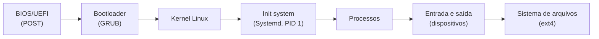

# **Encerramento**

Com esta etapa, chegamos ao fim da nossa jornada. Partimos de um computador desligado e, passo a passo, percorremos todo o caminho até um sistema operacional GNU/Linux em pleno funcionamento, construído por nós:



>Diagrama 1: O caminho percorrido pelo framework, do botão de ligar aos arquivos.

<div align="center">

| **Módulo** | **Etapas** | **O que aprendemos** |
| :--: | :--: | :--: |
| **1 - Início** | BIOS/UEFI, Ambiente, Bootloader | Como o hardware desperta e entrega o controle ao software |
| **2 - Boot** | Kernel, Memória, Init | O papel do kernel, a diferença entre RAM e disco e o primeiro processo |
| **3 - Processos** | Init System, Processos | O Systemd como PID 1 e o ciclo de vida dos processos |
| **4 - Final** | Entrada e Saída, Sistema de Arquivos | Como o sistema conversa com o hardware e organiza os dados |

</div>

>Tabela 1: Resumo dos módulos do framework.

Ao longo do caminho, vimos que cada conceito está conectado aos demais: o `/dev` que o kernel preenche, o `/proc` que nos mostrou os processos, o `sync` que levou os dados da RAM ao disco, o Systemd que monta, inicia e supervisiona. Um sistema operacional não é uma peça única, e sim um conjunto de componentes simples e bem definidos que cooperam entre si.

Para encerrar, em vez de mais um passo a passo, deixaremos um **desafio**: agora é com você.

## **Desafio final: construa o seu "fetch"**

Programas como o **neofetch** e o **fastfetch** exibem, ao lado de um logo em ASCII, as principais informações do sistema. Por trás da aparência, eles não possuem nenhum segredo: apenas leem os mesmos arquivos que utilizamos durante todo o framework e os organizam na tela.

A sua missão é criar o **`lecosfetch`**, uma versão própria para o LecOS, que mostre as informações do sistema ao lado de um logo escolhido pelo usuário. Não existe um único caminho: você decide a linguagem, a estrutura do código, o visual e os detalhes. O que não é negociável são os **objetivos** descritos abaixo, pois são eles que definem se o `lecosfetch` funciona.

Para ter uma ideia do resultado esperado, veja um exemplo (apenas ilustrativo: o seu layout, os rótulos e o logo podem ser completamente diferentes):

```text
  .----------------.   root@lecos
  |                |   -----------
  |   _            |   SO        LecOS (x86_64)
  |  | |           |   Kernel    6.12.108
  |  | |           |   Init      systemd
  |  | |_____      |   Uptime    12 min
  |  |_______|     |   Processos 38
  |                |   RAM       41 MiB / 1985 MiB (2%)
  '----------------'   Disco     312M / 9.8G (4%)
        LecOS
```

>Exemplo 1: Possível saída do `lecosfetch`.

### **Regras**

* O programa deve funcionar **dentro do LecOS**, utilizando apenas os componentes que já estão instalados (Bash, GNU Coreutils, Util-Linux, GNU Inetutils, entre outros). Lembre-se de que o sistema **não possui** ferramentas como `ps`, `grep`, `sed` ou `awk`;
* A linguagem é livre, desde que a regra anterior seja respeitada. O Bash é o caminho natural, pois já está no sistema. Se optar por um programa compilado, lembre-se de que o LecOS não possui compilador: ele precisará ser gerado no contêiner e funcionar com a Glibc do sistema;
* Você pode se inspirar no funcionamento do neofetch e do fastfetch, mas **não** os instale: o objetivo é construir a sua própria versão.

### **Objetivos obrigatórios**

<div align="center">

| **Nº** | **Objetivo** | **Como verificar** |
| :--: | :--: | :--: |
| 1 | O comando `lecosfetch` deve poder ser executado de **qualquer diretório** | Execute `cd /` e depois `lecosfetch`. O comando `command -v lecosfetch` deve exibir o caminho do programa |
| 2 | Exibir, no mínimo, estas oito informações: **usuário@máquina**, **sistema operacional** (o nome definido no `/etc/os-release`), **kernel**, **init** (o nome do PID 1), **tempo ligado**, **quantidade de processos**, **memória** (usada/total) e **disco** da raiz (usado/total) | Confira visualmente se todas aparecem |
| 3 | As informações devem ser **lidas do sistema em tempo real**, e não escritas no código | Execute o `lecosfetch`, depois `sleep 300 &` e execute novamente: a quantidade de processos deve aumentar. O tempo ligado também deve crescer, e todos os valores devem bater com as fontes originais (`cat /proc/uptime`, `df -h /`, etc.) |
| 4 | Exibir o logo à **esquerda** e as informações à **direita**, alinhados, sem quebrar linha em uma tela de **80 colunas** | Observe a saída no QEMU, com o logo padrão |
| 5 | Os logos devem ficar no diretório **`/usr/share/lecosfetch/logos/`**, um arquivo **`NOME.txt`** para cada logo, e devem existir **pelo menos dois** | `ls /usr/share/lecosfetch/logos` |
| 6 | O arquivo **`/etc/lecosfetch.conf`** deve conter uma linha **`LOGO=NOME`**, que define o logo usado quando nenhuma opção é informada | Altere o valor de `LOGO` para outro logo e execute `lecosfetch` sem opções: o logo deve mudar |
| 7 | Aceitar as opções **`-l NOME`** (usa o logo informado, mesmo que o arquivo de configuração indique outro), **`-L`** (lista os logos disponíveis, um nome por linha, sem o `.txt`) e **`-h`** (exibe uma ajuda) | Teste as três opções |
| 8 | Ser **robusto e seguro**: (a) logo inexistente deve gerar uma mensagem de erro e terminar com código de saída diferente de 0; (b) nomes de logo que tentem sair do diretório, como `../secreto`, devem ser **recusados**; (c) se o `/etc/lecosfetch.conf` não existir, o programa deve continuar funcionando com um logo padrão | (a) `lecosfetch -l naoexiste; echo $?`. (b) Crie `/usr/share/lecosfetch/secreto.txt` com um texto qualquer e execute `lecosfetch -l ../secreto; echo $?`: o texto **não** pode aparecer. (c) Renomeie o `.conf`, execute o programa e depois devolva o nome |

</div>

>Tabela 2: Objetivos obrigatórios do desafio e como verificá-los.

> O código de saída do último comando fica na variável `$?`. Um programa que terminou com sucesso retorna `0`.

### **Os logos**

O logo é apenas um arquivo de texto. Para que ele fique bem alinhado, escolha o formato com cuidado:

* Utilize **somente caracteres ASCII**, sem acentos nem emojis;
* Evite tabulações (`Tab`): utilize espaços;
* Mantenha-o com no máximo cerca de **30 colunas** por **15 linhas**, para que caiba na tela de 80x25 junto das informações;
* Quem quiser transformar uma imagem em arte ASCII pode usar qualquer gerador no sistema principal e copiar o resultado para o LecOS, respeitando as regras acima.

### **Onde desenvolver**

Você pode escolher o ambiente que preferir.

**Opção A: direto no LecOS.** Como o disco é persistente, tudo o que você criar com o `nano` permanece após reiniciar. Será necessário criar os diretórios (`mkdir -p`) e dar permissão de execução ao seu programa (`chmod +x`).

**Opção B: no contêiner de desenvolvimento.** Escreva os arquivos na pasta `/LOS/root`, na posição em que ficarão dentro do sistema (por exemplo, `root/usr/bin/lecosfetch`, `root/etc/lecosfetch.conf` e `root/usr/share/lecosfetch/logos/`), e depois monte a imagem e copie **somente os seus arquivos** para ela, como fizemos nas etapas anteriores:

```bash
# Montamos a imagem em /mnt
mknod /dev/loop0 b 7 0
losetup -fP --show lecos.img
kpartx -av /dev/loop0
mount /dev/mapper/loop0p1 /mnt

# Copie os seus arquivos para as mesmas posições dentro de /mnt
# (por exemplo: cp root/usr/bin/lecosfetch /mnt/usr/bin/lecosfetch)

# Sincroniza, desmonta e remove o loop device
sync
umount /mnt
kpartx -d /dev/loop0
losetup -d /dev/loop0
```

### **Concluindo o desafio**

Quando terminar, execute todas as verificações da Tabela 2 e confirme que cada objetivo foi atendido. Para registrar a conquista, execute o `lecosfetch` com dois logos diferentes e tire uma captura de tela de cada um.

<div align="center">


</div>

> Imagem 1: Exemplo do `lecosfetch` em ação.

## **O que praticamos**

<div align="center">

| **Habilidade** | **Etapa relacionada** |
| :--: | :--: |
| Descobrir informações do sistema lendo `/proc`, `/sys` e `/etc` | Processos, Memória e Kernel |
| Ler arquivos linha a linha e tratar texto com o Bash | Entrada e Saída |
| Organizar programas, configurações e dados nos diretórios do FHS | Sistema de Arquivos |
| Tornar um programa executável e disponível no `PATH` | Sistema de Arquivos |
| Instalar arquivos na imagem do sistema | Bootloader |
| Validar entradas e tratar erros com códigos de saída | Processos e Entrada e Saída |

</div>

>Tabela 3: Habilidades exercitadas no desafio.

## **Considerações finais**

O LecOS é, de propósito, minimalista. Uma distribuição completa soma a ele componentes como um gerenciador de pacotes, configuração de rede, gerenciamento de usuários e uma interface gráfica, todos sobre essa mesma base. Agora, quando você instalar ou utilizar qualquer distribuição GNU/Linux, saberá exatamente o que acontece desde o momento em que aperta o botão de ligar. Parabéns por ter chegado até aqui!