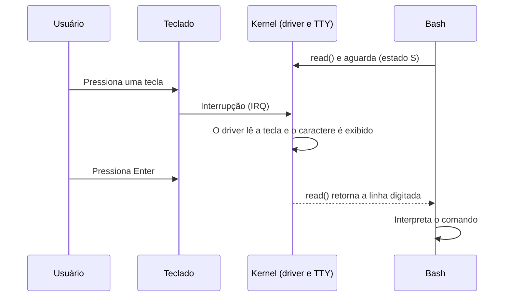
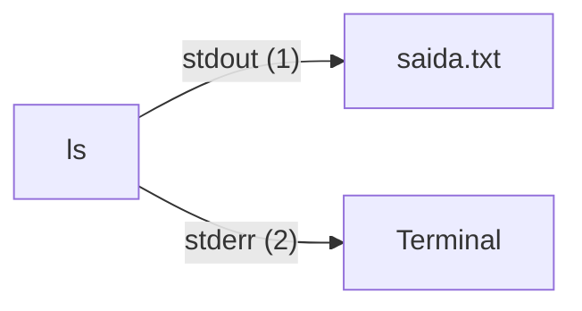
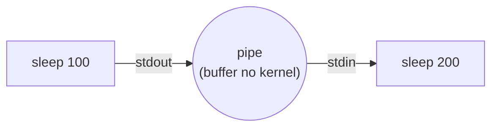

# **Entrada e Saída**

Ao longo das etapas anteriores, construímos um sistema capaz de iniciar, executar processos e mantê-los sob a supervisão do Systemd. No entanto, um sistema que apenas executa programas, mas não consegue receber ou entregar dados, teria pouca utilidade: ele não leria o que digitamos, não exibiria nada na tela e nem gravaria informações no disco.

A **entrada e saída** (*Input/Output*, ou simplesmente **E/S**) é justamente a parte do sistema operacional responsável por essa comunicação com o mundo externo. Nesta etapa, veremos como o kernel Linux intermedia o acesso aos dispositivos, por que no Linux "quase tudo é um arquivo", como os programas recebem e enviam dados e, no final, observaremos tudo isso funcionando dentro do LecOS.

## **O que é entrada e saída?**

Chamamos de **entrada** os dados que chegam ao sistema (o que digitamos no teclado, o que lemos do disco, o que recebemos pela rede) e de **saída** os dados que saem dele (o texto exibido na tela, o arquivo gravado no disco, o pacote enviado pela rede). Os componentes que realizam essas operações são os **dispositivos de E/S**, e alguns deles trabalham nas duas direções:

<div align="center">

| **Dispositivo** | **Entrada** | **Saída** |
| :--: | :--: | :--: |
| Teclado | Sim | Não |
| Monitor | Não | Sim |
| Disco (SSD/HDD) | Sim | Sim |
| Placa de rede | Sim | Sim |

</div>

>Tabela 1: Exemplos de dispositivos de entrada e saída.

Como vimos na etapa do Kernel, os programas executam em **modo usuário**, sem acesso direto ao hardware. Quando precisam ler ou escrever algo, eles pedem ao kernel através de **chamadas de sistema** (como `read()` e `write()`). O kernel, em **modo núcleo**, utiliza os **drivers** (os componentes que conhecem os detalhes de cada dispositivo) para realizar a operação e devolve o resultado ao programa.


>Diagrama 1: Caminho percorrido pelos dados entre um programa e um dispositivo.

Graças a essa intermediação, o programa não precisa saber se está lendo de um teclado ou de um disco, e o kernel garante que um programa não interfira no acesso de outro. Como o Linux possui um kernel monolítico, esses drivers fazem parte do próprio kernel, executando em modo núcleo.

## **No Linux, tudo é um arquivo**

Uma das ideias centrais da filosofia Unix é representar os recursos do sistema como **arquivos**. Assim, os programas utilizam o mesmo pequeno conjunto de operações (abrir, ler, escrever e fechar) para trabalhar com arquivos comuns, dispositivos, terminais e até a comunicação entre processos. A vantagem é enorme: o mesmo comando `cat` pode exibir o conteúdo de um texto gravado no disco ou o que está sendo recebido de outro lugar, sem precisar ser alterado.

> Na prática, "tudo é um arquivo" é uma simplificação. As interfaces de rede, por exemplo, não aparecem como arquivos em `/dev` e são acessadas por meio de outro mecanismo, chamado *socket*.

### **O diretório /dev**

Os dispositivos ficam acessíveis em arquivos especiais dentro do diretório `/dev`. Lembra da linha `mount -t devtmpfs devtmpfs /dev` do nosso antigo script `init`? O `devtmpfs` é um sistema de arquivos virtual no qual **o próprio kernel cria os arquivos de dispositivo** conforme os detecta. No LecOS, essa montagem passou a ser feita pelo Systemd.

Os arquivos de dispositivo se dividem em dois tipos principais, identificados pela primeira letra na saída do `ls -l`:

<div align="center">

| **Tipo** | **Letra** | **Como é acessado** | **Exemplos** |
| :--: | :--: | :--: | :--: |
| Dispositivo de caractere | `c` | Fluxo de bytes, um após o outro | Terminais (`tty1`), `/dev/null`, `/dev/urandom` |
| Dispositivo de bloco | `b` | Blocos de tamanho fixo, em qualquer posição | Discos e partições (`sda`, `sda1`) |

</div>

>Tabela 2: Tipos de arquivos de dispositivo.

Cada arquivo de dispositivo possui ainda dois números: o **major**, que identifica o *driver* responsável, e o **minor**, que identifica qual dispositivo desse driver. Por exemplo, os discos SCSI/SATA utilizam o major `8`: o primeiro disco (`sda`) é o `8,0`, e sua primeira partição (`sda1`) é o `8,1`.

Os nomes também seguem um padrão. Em `sda1`, o `sd` indica um disco SCSI/SATA, a letra `a` indica o primeiro disco encontrado e o número `1` indica a primeira partição. É por isso que o nosso `grub.cfg` utiliza `root=/dev/sda1`, e é o mesmo motivo pelo qual, dentro do contêiner, nossa imagem montada aparecia como `loop0p1`.

## **Como o kernel conversa com o hardware**

Como o kernel descobre que uma tecla foi pressionada, ou que o disco terminou de gravar um arquivo? Existem três estratégias:

* **Polling (consulta)**: o kernel pergunta ao dispositivo, repetidamente, se há algo novo. É simples, mas desperdiça CPU;
* **Interrupções**: é o dispositivo que avisa o processador, através de um sinal chamado **IRQ**, quando algo acontece. O processador pausa o que fazia, executa o trecho do driver que trata o aviso e depois retoma o trabalho. É o método mais comum;
* **DMA** (*Direct Memory Access*): para grandes volumes de dados, o dispositivo transfere os dados diretamente de/para a memória RAM, sem que a CPU precise copiar byte a byte, avisando por uma interrupção apenas ao final.

O caminho completo de uma simples tecla até o nosso shell mostra como tudo se encaixa:



>Diagrama 2: Do teclado ao Bash. Enquanto aguarda, o shell fica em estado `S`, exatamente como vimos na etapa de Processos.

### **Terminais**

Na etapa do Kernel, vimos que **terminal e shell não são a mesma coisa**. O terminal, no nosso caso, é um dispositivo: o console virtual `/dev/tty1`. A camada de terminais do kernel (TTY) fica entre o teclado e o shell e cuida de tarefas como exibir o que digitamos (o *eco*), tratar a tecla de apagar e transformar `Ctrl` + `C` em um sinal `SIGINT` para o processo que está em primeiro plano. Ou seja, o Bash recebe uma linha já pronta, e boa parte do "trabalho sujo" é feita pelo kernel.

## **Descritores de arquivo e fluxos padrão**

Quando um processo abre um arquivo ou um dispositivo, o kernel devolve um número inteiro pequeno chamado **descritor de arquivo** (*file descriptor*, ou **fd**). É esse número que o processo utiliza nas chamadas `read()` e `write()` seguintes. Todo processo já começa com três descritores abertos:

<div align="center">

| **fd** | **Nome** | **Função** | **Padrão** |
| :--: | :--: | :--: | :--: |
| 0 | `stdin` | Entrada padrão: de onde o programa lê | Terminal |
| 1 | `stdout` | Saída padrão: onde escreve os resultados | Terminal |
| 2 | `stderr` | Erro padrão: onde escreve as mensagens de erro | Terminal |

</div>

>Tabela 3: Os três descritores de arquivo padrão.

Foram exatamente esses números que vimos em `/proc/PID/fd` na etapa anterior, todos apontando para o terminal. O motivo de existirem duas saídas (`stdout` e `stderr`) é permitir separá-las: podemos guardar os resultados de um comando em um arquivo e, ainda assim, continuar vendo seus erros na tela.

### **Redirecionamento**

Como o programa só enxerga os números `0`, `1` e `2`, o shell pode trocar o destino de cada um **antes de executá-lo**, sem que o programa perceba. Isso é o **redirecionamento**:

<div align="center">

| **Operador** | **Efeito** | **Exemplo** |
| :--: | :--: | :--: |
| `>` | Envia a saída padrão para um arquivo (sobrescrevendo) | `ls > lista.txt` |
| `>>` | Envia a saída padrão para um arquivo (acrescentando ao final) | `echo oi >> lista.txt` |
| `<` | Lê a entrada padrão de um arquivo | `wc -l < lista.txt` |
| `2>` | Envia a saída de erro para um arquivo | `ls /x 2> erro.txt` |
| `2>&1` | Envia o erro para o mesmo lugar que a saída padrão | `ls /x > tudo.txt 2>&1` |

</div>

>Tabela 4: Principais operadores de redirecionamento do Bash.



>Diagrama 3: Efeito do comando `ls > saida.txt`: a saída vai para o arquivo, enquanto os erros continuam no terminal.

### **Pipes**

O **pipe** (`|`) conecta a saída padrão de um processo diretamente à entrada padrão de outro, utilizando um pequeno *buffer* mantido na memória do kernel. Em `comando1 | comando2`, o shell cria os dois processos (cada um com um `fork()`, como vimos), e eles executam **ao mesmo tempo**: o segundo consome os dados à medida que o primeiro os produz.



>Diagrama 4: Dois processos conectados por um pipe.

O pipe comum existe apenas enquanto os processos estão rodando. Existe também o **pipe nomeado** (*FIFO*), que possui um nome visível no sistema de arquivos e permite que processos independentes se comuniquem. Ele é criado com o comando `mkfifo` e aparece com a letra `p` no `ls -l`.

### **Dispositivos especiais**

Alguns arquivos de dispositivo não correspondem a nenhum hardware físico, mas são extremamente úteis:

<div align="center">

| **Arquivo** | **Comportamento** |
| :--: | :--: |
| `/dev/null` | Descarta tudo o que for escrito nele. Ao ser lido, não retorna nada |
| `/dev/zero` | Ao ser lido, fornece uma sequência infinita de bytes zero |
| `/dev/urandom` | Ao ser lido, fornece bytes aleatórios |
| `/dev/tty` | Representa o terminal do processo que o utiliza |
| `/dev/sda` | O disco inteiro, como uma sequência de blocos |

</div>

>Tabela 5: Dispositivos especiais mais utilizados.

## **Colocando em prática**

Chegou a hora de observar tudo isso no LecOS. Utilizaremos apenas o que já temos instalado: o Bash, o GNU Coreutils e o `lps` que criamos na etapa anterior. Todos os experimentos acontecem **dentro do LecOS**, então inicie o sistema no QEMU e faça o login normalmente.

> **NOTA**: assim como nas etapas anteriores, a função de colar não funciona no QEMU. Digite os comandos manualmente, sem os comentários (o que vem após o `#`).

### **Experimento 1: conhecendo os arquivos de dispositivo**

Vamos listar alguns dos arquivos de dispositivo que mencionamos:

```bash
ls -l /dev/null /dev/zero /dev/urandom /dev/tty1 /dev/sda /dev/sda1
```

Observe a **primeira letra** de cada linha: os dispositivos `null`, `zero`, `urandom` e `tty1` são `c` (caractere), enquanto `sda` e `sda1` são `b` (bloco). Repare também que, no lugar do tamanho do arquivo, aparecem dois números separados por vírgula: são o **major** e o **minor**. O `sda` deve ser `8, 0` e o `sda1`, `8, 1`.

Para ver como o kernel enxerga os discos e as partições:

```bash
cat /proc/partitions
```

A lista deve conter o `sda` (o disco inteiro, de aproximadamente 10 GB) e o `sda1` (a partição que criamos com o `fdisk` na etapa do Bootloader).

### **Experimento 2: fluxos padrão e redirecionamento**

Primeiro, vamos ver os descritores do nosso próprio shell, como fizemos com o `sleep`:

```bash
ls -l /proc/$$/fd
```

Os descritores `0`, `1` e `2` apontam para o terminal (`/dev/tty1`). Pode aparecer também um `255`, que é utilizado internamente pelo Bash.

Agora, vamos separar a saída dos erros. O comando `ls` abaixo recebe dois caminhos: um que existe e outro que não:

```bash
# Saída e erro misturados no terminal
ls /etc /nao-existe

# Cada fluxo em um arquivo diferente
ls /etc /nao-existe > saida.txt 2> erro.txt
```

No segundo comando, nada aparece na tela. A lista de arquivos foi para `saida.txt` e a mensagem de erro foi para `erro.txt`:

```bash
cat erro.txt
wc -l < saida.txt
```

O `wc -l`, que conta linhas, recebeu o conteúdo do arquivo pela entrada padrão (`<`), sem que precisássemos informar o nome do arquivo a ele.

### **Experimento 3: pipes e a relação com os processos**

Vamos começar com um pipe simples, que envia o resultado do `echo` para o `wc -c` (que conta caracteres):

```bash
echo "LecOS" | wc -c
```

O resultado é `6`: as cinco letras mais o caractere de nova linha. Agora vamos ver um pipe "por dentro". Os dois `sleep` abaixo ficarão conectados e em execução ao mesmo tempo:

```bash
sleep 100 | sleep 200 &
lps -t
```

Na árvore, os dois `sleep` aparecem como **filhos do mesmo shell**: o Bash criou dois processos. Guardaremos o PID de cada um (o `$!` guarda o último processo do pipeline, e o `jobs -p`, o primeiro) e vamos olhar os seus descritores:

```bash
P2=$!
P1=$(jobs -p | head -n 1)

ls -l /proc/$P1/fd/1 /proc/$P2/fd/0
```

A saída padrão do primeiro e a entrada padrão do segundo apontam para o mesmo `pipe:[número]`. Esse número identifica o *buffer* que o kernel criou para conectá-los. Para encerrar os dois:

```bash
kill $P1 $P2
```

### **Experimento 4: um pipe nomeado**

Agora, vamos criar um pipe com nome e usá-lo para conversar entre dois processos:

```bash
# Cria o pipe nomeado
mkfifo canal
ls -l canal

# O 'cat' aguarda, em segundo plano, a chegada de dados
cat canal &

# Envia uma mensagem pelo canal
echo "Olá pelo canal" > canal

# Remove o pipe
rm canal
```

No `ls -l`, a primeira letra é `p`, de *pipe*. Assim que o `echo` escreve, o `cat` (que estava bloqueado em `read()`) recebe a mensagem e a exibe. O arquivo `canal` nunca guardou o texto no disco: ele apenas indica o ponto de encontro dos dois processos, e os dados passaram pelo buffer do kernel.

### **Experimento 5: dispositivos especiais**

Vamos utilizar os dispositivos especiais. O comando `od` (*octal dump*), do Coreutils, exibe os bytes de um arquivo em formato legível, e o `head -c` limita a quantidade de bytes lidos:

```bash
# Tudo o que for escrito em /dev/null desaparece
echo "isto some" > /dev/null

# 8 bytes lidos de /dev/zero
head -c 8 /dev/zero | od -An -tx1

# 8 bytes lidos de /dev/urandom (repita e compare)
head -c 8 /dev/urandom | od -An -tx1
```

O `/dev/zero` fornece sempre `00`, enquanto o `/dev/urandom` fornece valores diferentes a cada execução.

### **Experimento 6: o terminal como dispositivo**

```bash
# Qual dispositivo é o nosso terminal?
tty
ls -l $(tty)

# Escrever no arquivo do terminal exibe o texto na tela
echo "Escrevi direto no terminal" > $(tty)
```

O comando `tty` informa o arquivo de dispositivo do terminal atual (`/dev/tty1`), que é um dispositivo de caractere. Escrever nele faz o texto aparecer na tela, pois a **tela é a saída** desse dispositivo.

Para ver o kernel tratando o terminal, vamos desligar o eco com o `stty`:

```bash
stty -echo
```

Digite qualquer coisa: nada aparece na tela, pois o kernel deixou de exibir as teclas digitadas. Para restaurar, digite `stty echo` e pressione `Enter` (mesmo sem enxergar o que digitou).

### **Experimento 7: interrupções do teclado**

O kernel mantém um contador de interrupções para cada dispositivo. Vamos olhar os primeiros registros:

```bash
head -n 5 /proc/interrupts
```

Procure a linha referente ao teclado (geralmente `i8042`). Cada coluna numérica corresponde a uma CPU, e o restante da linha indica o controlador e o *driver* responsável. Agora, digite algumas teclas à vontade e execute o comando novamente:

```bash
head -n 5 /proc/interrupts
```

O contador do teclado aumentou. Cada tecla que você pressionou gerou interrupções que o driver precisou tratar, exatamente como no Diagrama 2.

### **Experimento 8: lendo o disco "cru"**

Como o `/dev/sda` é um dispositivo de bloco, podemos ler os bytes do disco diretamente. Lembra do **MBR**, os primeiros 512 bytes do disco que estudamos na etapa da BIOS/UEFI e onde o GRUB foi instalado? Vamos olhar para ele. A opção `-j` indica quantos bytes pular e a `-N`, quantos bytes ler:

```bash
# Os dois últimos bytes do MBR (posição 510)
od -An -tx1 -j510 -N2 /dev/sda

# O tipo da partição 1, registrado na tabela de partições (posição 450)
od -An -tx1 -j450 -N1 /dev/sda
```

O primeiro comando deve exibir `55 aa`: é a **assinatura de boot**, que a BIOS procura para saber se o disco é inicializável. O segundo deve exibir `83`, o código que identifica uma partição Linux, gravado pelo `fdisk` quando criamos a partição. Estamos lendo, diretamente do disco, informações que gravamos nas primeiras etapas do framework.

### **Experimento 9: acompanhando uma escrita no disco**

O kernel registra quantas operações cada disco já realizou. Vamos guardar esses números antes e depois de gravar um arquivo de 50 MB. O `dd` (*data duplicator*), do Coreutils, copia dados de um arquivo para outro, e aqui vamos copiar zeros do `/dev/zero`:

```bash
# Lê os contadores do disco (e = escritas; g = setores gravados)
read -r a b c d e f g _ < /sys/block/sda/stat
echo "Escritas: $e | Setores gravados: $g"

# Grava 50 arquivos de 1 MB (50 MB) e força a gravação no disco
dd if=/dev/zero of=teste.bin bs=1M count=50
sync

# Lê os contadores novamente
read -r a b c d e f g _ < /sys/block/sda/stat
echo "Escritas: $e | Setores gravados: $g"

# Remove o arquivo de teste
rm teste.bin
```

Compare os dois resultados: o número de **setores gravados** aumentou em cerca de 100 mil. Isso faz sentido: um setor tem 512 bytes, e 50 MB ÷ 512 bytes ≈ 102 mil setores (o valor exato é um pouco maior por conta dos dados de controle do sistema de arquivos, que veremos na próxima etapa). Esse experimento também ilustra a relação com a memória que estudamos: o `dd` primeiro escreve na **memória primária** (RAM), e o `sync` obriga o kernel a transferir os dados para a **memória secundária** (disco). Foi exatamente por isso que repetimos o `sync` antes de desmontar a imagem em várias etapas do framework.

### **Experimento 10: a rede não é um arquivo**

As interfaces de rede não aparecem em `/dev`, mas o kernel também as expõe:

```bash
# Interfaces de rede conhecidas pelo kernel
ls /sys/class/net

# Contadores de bytes e pacotes de cada interface
cat /proc/net/dev
```

A interface `lo` (*loopback*) existe em qualquer sistema e serve para o computador conversar consigo mesmo. Vamos gerar tráfego nela com o `ping`, do GNU Inetutils, e comparar os contadores:

```bash
ping -c 3 127.0.0.1
cat /proc/net/dev
```

Os contadores de pacotes recebidos e transmitidos da `lo` aumentaram. Mesmo sem nenhum arquivo em `/dev`, o kernel contabiliza toda a E/S de rede.

> Para sair do comando `ping` antes do fim, utilize `Ctrl` + `C`, que, como vimos, é entregue ao processo como o sinal `SIGINT`.

## **O que vimos na prática**

<div align="center">

| **Experimento** | **Conceito demonstrado** |
| :--: | :--: |
| 1 | Dispositivos de caractere e de bloco, major e minor |
| 2 | Descritores `0`, `1` e `2` e redirecionamento |
| 3 | Pipes e a relação com `fork()` e processos |
| 4 | Pipes nomeados (FIFO) |
| 5 | Dispositivos especiais: `/dev/null`, `/dev/zero` e `/dev/urandom` |
| 6 | O terminal como dispositivo e a camada TTY |
| 7 | Interrupções de hardware |
| 8 | Leitura direta do disco: MBR e tabela de partições |
| 9 | Do cache na RAM ao disco: `sync` e setores gravados |
| 10 | E/S de rede e os contadores do kernel |

</div>

>Tabela 6: Resumo dos experimentos e dos conceitos relacionados.

## **Conclusão**

Nesta etapa, vimos como o sistema operacional se comunica com o mundo externo: os programas pedem ao kernel, os drivers conversam com o hardware e o resultado volta por meio de arquivos, descritores e fluxos. Também vimos como o shell utiliza redirecionamentos e pipes para combinar programas simples em tarefas mais complexas, e verificamos que até o MBR do nosso disco pode ser lido como uma simples sequência de bytes.

Esse último ponto nos leva à etapa final do framework. O `/dev/sda1` é apenas uma sequência de blocos, mas não é assim que enxergamos nossos dados: lidamos com **arquivos e diretórios**, com nomes, donos e permissões. Quem transforma esses blocos em uma estrutura organizada é o **sistema de arquivos**, tema da próxima etapa.